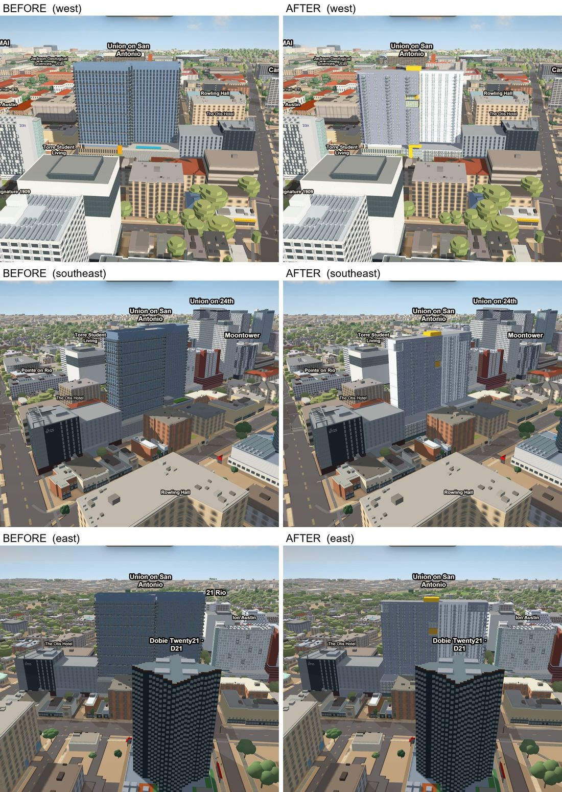
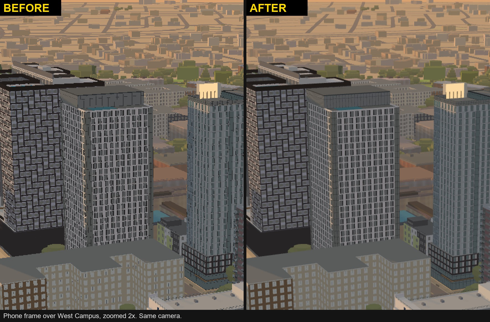
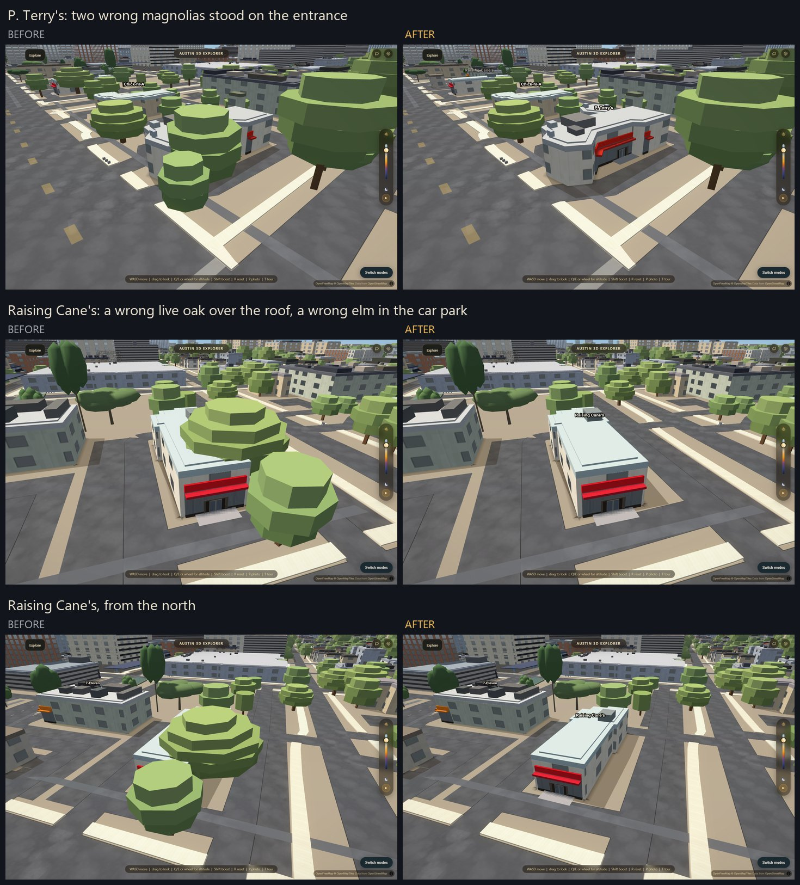

# Austin 3D Explorer — Full Handoff

## Oct 26 2026 (evening) — Welch, clay roofs, Anna Hiss, McCombs; cheaper builds (#569, #570, #571, #574)

- #569 Welch Hall Speedway face from site photographs (t_0_-1): brick from 79 real bricks, 5.45 m limestone base with arches, three 4.41 m storeys (live had four rows and a wall 4 m too tall), north glazed bay over the tunnel, grey band at the 2021 scan level.
- #570 clay tile roofs: one de-lit clay-tile texture from a site photograph, applied at load time to the clay roofs of 54 campus Blender builds by material name (`v2/clay.js`, `v2/data/roof_glass.json`, `LOOK.CLAY` in `v2/look.js`, mip bias -0.15; `?clay=0` off); no tile rebuilt. Campus-wide glass was tried and dropped: pane tones differ by building (Biological Laboratories 11/14/74 % dark/mid/pale, Moffett 58/33/9 %); glass goes per building next.
- Cost: builders averaged ~200 tool calls and ~1 % of the weekly plan per building. New private tools make the routine end steps one command (`ship_building.sh`: single-tile build, unchanged proof, photo|live|new sheets, shimmer/blur A/B, demo checks) behind a GPU lock; gates are relative to main (shimmer <= main + 0.02, blur <= max(main, 0) + 0.01). #571 Anna Hiss Gymnasium (photo brick, semicircular passage arch) took 65 calls and about 0.2 % of the week.
- #574 (carrying #573) McCombs School of Business wall brick from 3,207 real bricks of a site photograph, plus `v2/brick-mips.js`: a custom mip chain for photo brick (head joints, then courses, averaged out at coarse levels) that removes a diagonal moire seen at full size although every automatic gate passed. Opt-in per building (`BRICK_MIPS_SLUGS` in `v2/look.js`, McCombs only): it failed the blur gate on Gregory Gym and is unmeasured on the other photo-brick buildings. Parked: #568 Gates Dell (slat screens: shimmer or blur), #572 Gregory Gym (blur). Live checks: each tile on the Pages mirror equals main; 7-view demo checks 0 problems.

## Oct 26 2026 — five more campus buildings with materials from the site photographs (#562, #563, #564, #567 with #565 and #566)

Same method as Schoch (#561), now written as a private playbook so each builder does it in one pass: geometry measured and fixed through a camera proven on the building's own pattern (held-out picks), materials cut from the site photographs with the light divided out (`scripts/v2/photo_materials.json`, textures under `scripts/v2/materials/<slug>/`), judged photo | live | new under a sky matched per photo, shipped only if clearly closer on every changed part with shimmer and the blur measure not worse. Each live check: the tile file on the Pages mirror equals main; 7-view demo checks 0 problems.
- #562 Physics, Math and Astronomy (t_1_-2): the east side, guessed before, built from four photographs: escalator lobby glass, entrance glass, dark window, blinds as photographed; brick + precast textures (51 KB). New per-building `filter` (anisotropy, mip bias) in photo_materials.json read by `v2/tiles.js` (`?photoaniso=`, `?photobias=`), because far textures raised the blur measure; window-frame fade removed.
- #563 Hogg Memorial Auditorium (t_-1_-1): shell stone and jointed limestone (112 KB); hall north wall rebuilt (3 tall 8x8 windows, frieze panels, pilasters, red door moved). One photograph thought to be Hogg was the Texas Union: GPS matches must be checked by eye.
- #564 Biological Laboratories (t_-1_-1): brick from 323 real bricks; west half (plain before) mirrors the ornate east half; arched doors; roof face; ridge 23.8 m from the photograph (the 2021 scan reads lower; photo wins).
- #567 merged #565 Moffett Molecular Biology (t_0_-2: stair tower 4.65 m with the holed block behind, 4-row frieze, entrance bay, shell stone/ashlar/limestone 32 KB) and #566 T. S. Painter Hall (t_0_-1: south block 2.45 m too tall before, eave 15.17 m, brick from 1187 real bricks, limestone frame, doors, stair landing), together so CI ran once; photo_materials.json conflicts are unions of building keys.
- Open, many buildings: clay tile roofs read brown-grey instead of red; the app's glass reads pale blue where the photographs are dark; ground is flat where steps and terraces exist. In progress: Welch Hall (#569, ready), Gates Dell (#568, draft, second round: rust slat screens).

## Oct 26 2026 — E. P. Schoch with materials taken from the site photographs (#561)

#561 merged (16 of 16 CI). First building with materials taken FROM photographs (CLAUDE.md rule 16, new paragraph, owner 10-24/10-26): 47 real bricks cut from a site photograph with the light divided out, laid in the measured running bond (512 px colour map + 256 px mortar normal), a limestone map, steel frame colour from the photo pixels; textures in `scripts/v2/materials/e-p-schoch-building/` (96 KB), applied by `scripts/v2/photo_materials.json`, which `build_tiles.mjs` now reads. Geometry corrected from the photographs (private build out-v3, registered in BUILDS.json; `scripts/v2/sources.py` now finds out-v3 folders): modular brick 0.0677 m per course (was 0.093), stone band 3.72-4.16 m, frieze 11.44 m, storey windows 2.31 x 2.1 m with 8 x 6 panes, tall entrance window 6 x 12 panes, entrance portal 3.20 m with stepped frame and three-tier hood, round lanterns, westmost north windows moved 1.15 m. Eave brackets, soffit trim and downpipes kept in the near model and faded by pixel coverage (`v2/tiles.js`, only materials the tile build marks). Shimmer unchanged (north 600 m 1.11 -> 1.15). Tile t_1_0 988,524 -> 1,228,336 bytes; every other tile byte-identical. Live: t_1_0 on the Pages mirror equals main; 7-view demo checks 0 problems. Open: the second photograph's camera (held-out median 8.7 px), the west face reads pinker, the door recess shows sky, eave brackets dark where the photo is pale, pane tones too evenly checkered. Also 10-26: CLAUDE.md rule 16 now allows de-lit materials from photographs (building surfaces only).

## Oct 25 2026 — v2 speed pass for sky/glass/trees (#555); Butterfly Bridge built from photographs (#557); glass, trees, camera solver and Block 185 not shipped

#555 merged as ec0433b6 (16 of 16 CI after four new GPU tools went to `laptop_only`: v2-view-shots, v2-moment-shots, v2-trees-shimmer, v2-split). It carries #551 sky of a moment (`?moment=`), #552 captured CC0 skies, #553 per-pane glass (on), #554 the tree library (`?trees=real`, off) and a speed pass: the ground shade reads a baked ground-lit map (15-20 ms saved, `?groundlit=0` old), static far crown band, grid search, trimmed cards, far crowns lit like mid crowns (no hand-over pop). Real trees stay off: Mac desktop street view 1.92x main (leaf-card overdraw). `scripts/verify/v2-split.mjs` measures each layer from one page load. The green stair-step ground patches near DKR are in tile t_2_0's own mesh.
#557 merged as 7ceeebb4 (16 of 16 CI on the branch, then main merged in: conflicts in v2/main.js imports and checks.json, both sides kept; 7-view demo checks on the merge and on the live Pages mirror: 0 covers of 2,434, 90 names, 0 overlaps, 37 pins, 0 page errors). The arch in front of The Independent at the site photograph is the Butterfly Bridge (W 2nd St over Shoal Creek, OSM way 353040169): Blender model from site photographs, public pictures and the 2021 scan (11.5k triangles; app copy 3.6k in t_-5_8). The two "flat slabs" were sidewalks seen from below (the solved camera had been 3.9 m underground). Cables, sockets and rails are drawn by `v2/wires.js` as screen-space ribbons whose opacity is their pixel coverage (rule 15: shimmer 1.11 -> 0.31; `?wires=0` off; `scripts/verify/v2-wire-shimmer.mjs`). A phantom tower on The Independent's podium (scan points of its cantilevers) is capped at 25.4 m (`MASSING_CAP_M` in v2/city-worker.js). Open: hanger spacing not settled; Block 185 drawn solid to the ground where it stands on columns.
Not shipped: #556 glass reflections (sharp sky per pixel, clouds; lit glass dE 14.5 -> 3.1) CLOSED, the owner rejected the look ("flat reflection and wrong color"); #559 trees placed from the 2021 scan (102,922 trees, good positions) parked, the solid-crown look reads as clay lumps; #558 Block 185 parked, cameras fail the gate (the 2021 scan predates the tower; its fins defeat an automatic line fit); a joint structure-from-motion camera solver over the site photographs failed (a walk, 1-4 frames per spot; private tool kept). Running: Sixth and Guadalupe in Blender with the in-photo camera method.

## Oct 25 2026 — v2 renderer matches Blender under the same light; exact-photo pilot tools (#548, #550)

#550 merged as aa0e8bfb (16 of 16 CI after moving v2-exact.mjs and v2-aim-shots.mjs to laptop_only: they need private trial files / a real GPU); it carries #548's exact-photo pilot code (v2/exact-pilot.js, scripts/verify/v2-exact.mjs, sun override), inert unless a trial manifest asks. Live 7-view check after the deploy: covers 0 of 2,434, 90 names, 0 overlaps/dups/hidden, 37 pins, 0 page errors.
- Owner's bar (10-24): exact copies of his photo moments. Pilot on The Independent at his photo IMG_1778: with the same model, camera and light, the app now matches Blender (sunlit concrete dE 2.0 to Blender, was 7.5). Fixes: `LOOK.SHADOW_AIM` (the shadow box follows the first building the view hits, so towers seen from the street get sun shadow; `?shadowaim=0` old), the probe's mirror sky gain, AO bake for single files (`ao_bake.mjs --file`).
- Main finding: the remaining gap to the photo is the light (one fixed afternoon sky), then glass per-pane variation, trees and sky detail. Draft PRs: #549 water (?water=1), #551 sky of a moment (?moment=). Running: real captured skies, glass per-pane reflections, a tree library, all judged at the owner's photo cameras.

## Oct 25 2026 — one name per building, no model poking through another's roof (#547)

#547 merged as 561e0ad5 (all CI green). Live check by the builder and the Mac lane (full-size live pictures). Moore-Hill showed "Moore-Hill Dormitory" and "Moore-Hill Residence Hall": `mergeFootprints` in v2/labels.js now makes a UT building whose doors lie on exactly one Blender model's outline that building (complexes, and two Blender models, never merge). `scripts/verify/v2-label-twins.mjs`: buildings with two names 22 -> 0. DKR's entry canopy (10 triangles in t_2_0) stood 0.3-0.5 m above Moncrief's roof: new stage `scripts/v2/clip_tiles.mjs` + `tile_clips.json` hides listed parts (NOTE: rebuilding t_2_0 brings it back until the stage runs); `scripts/verify/v2-tile-pokes.mjs`: 3 -> 2 (Icon over Villas on Nueces, known).

## Oct 21 2026 — six campus builds live after the demo: Moncrief-Neuhaus, Schoch, Winship, Pharmacy, Faulkner, Weaver (#539-#545)

Held until 18:00 CDT (the owner's CEO demo was on the frozen site). Merged together through #545 (c288f4d6): 16 of 16 CI jobs on the combined head; conflicts only in shared lists (manifest, inventory, app_copy, pair_views, BUILDS.md), joined three-way so each branch kept its own tile and building entries (all 8 tile files byte-equal to their branches; every manifest byte count equals its file). `v2-demo-checks` 7 views on the combined result locally and on the live Pages mirror after the deploy: 0 covers drawn of ~2,400, 0 name overlaps/duplicates/hidden names (91), 0 pin overlaps (37), 0 page errors. The Mac lane opened live aerials of each building at full size.
- Moncrief-Neuhaus Athletic Center (new tile t_2_1): rooftop practice field with the Longhorn, red hall roof, two tile roofs, the stepped San Jacinto face; meets DKR with no gap. Earth roofs within 0-3 px.
- E. P. Schoch (t_1_0): tile hip roof, skylight, 75 named windows, the owner's north entrance (tall stone surround), west frieze CHEMICAL ENGINEERING. Reviews 6.5 / 6.5.
- Winship Drama (t_1_0): stepped flat roofs, fly tower (west, not NE as the capture notes said), Street View confirms the name. Review 6.5.
- Pharmacy (t_0_-1): old tile-roofed block, newer block, the TEXAS PHARMACY footbridge; no camera passed. Review 7.
- Faulkner Nano Science (t_0_-1): limestone and brick, not glass; the lettered east entrance from the owner's photo. Review 6.5.
- Hal C. Weaver Power Plant (t_1_-1): 63 m chimney, Expansion with mansard roof, both cooling-tower banks, pipe racks. Review 6 before fixes. Chilling Station 6 still a plain block.
- Common limits: walls read flatter and smoother than the photos; shaded walls dark (the Light B shade issue; the `?shade=new` trial is on codex/v2-shade-colour, held for the owner's call). Campus 99 of 144.

## Oct 20 2026 — Calhoun Hall built from pictures, in v2 (#537)

#537 merged as ac6d8444 (16 of 16 CI green; main had not moved, so the merged head is the tested head; branch `mac/v2-calhoun`, deleted).

- **2026-10-20, Calhoun Hall into v2 (branch mac/v2-calhoun).** Opus build from 4 new Street View frames of the west walk, the 10-19 Earth corner views, the 2021 scan and the Commons east-face photo; shared Spanish kit imported from the Batts build. The building is the tile-roofed wing plus a four-storey north link to Parlin and a blank-walled south hall to Homer Rainey, each with a tile-roofed court arcade. Detailed 35,216 triangles, 243 named panes; app copy 17,026 (the building's one number is now 17,000). Reviews 7 -> 8 (no major left). Lessons: the reference notes had the building wrong (a "precast tower") and a photo's face mislabelled: identity and face come from the label, the outline and the scan, not from notes; a scan grid that does not reach the camera wraps its index and gives the camera wrong ground (the Street View fit was off by 1 m until found). Open: shaded walls dark (light B), east face rows 3-4 inferred (oaks), iron rails left out of the app copy (rule 15), shimmer 0.52-0.59 (Batts group 0.44-0.70).

## Oct 19 2026 — Jester West Hall: the Brazos St entrance and every other entrance (#535)

#535 merged as d4a55411 (all checks green on the merged head). Owner: "I don't see the Brazos entrance" / "Did you capture that side?" — we had it (Street View S01) and the build skipped it as "outside the outline". New photo-audit check 9o: every entrance from photos, OSM entrance nodes and the scan is built or has a written reason; the outline is data, not a limit. Mac lane's read of the live pictures: the porch reads right; the cream bands render as grey streaks in the app; door leaves plain; the Brazos camera pairs are approximate only.

- **2026-10-19 evening, Jester West Hall entrances (branch mac/v2-jester-entrances).** After the owner's "I don't see the Brazos entrance": every entrance listed from photos, new Street View (B01-B04), OSM entrance nodes and the scan, and built (Brazos porch, W entrance block, W storefront, 3 OSM doors). The NW arcade is Jester Center's by the scan. A fresh reviewer's 3 major items are fixed. Lesson: the earlier coverage list marked a photographed entrance "not built: outside the outline". The outline is data, not a boundary on evidence; every builder now lists entrances from OSM and the photos before the final.

## Oct 19 2026 — Main Building north side and wings rebuilt from photos (#536)

#536 merged at 21:28 (all checks green on the merged result; branch `mac/v2-main-building`); live Tower close-up re-shot. The Mac lane's read of the before/after: a real step (more openings, court gates, attic, the shaft moved 3.55 m to the scan position, the black band at the shaft foot gone), but the walls still read flat white in the app and the wing ends stay mostly blank; reviewers 5.5 then 7.

2026-10-19 evening, `mac/v2-main-building`: UT Main Building north side, wings, courts and light wells rebuilt from the owner's 2026 walk photos, Commons photos, Earth 3D (layout only) and the 2021 scan; the Tower shaft moved 3.55 m north to the scan and its heights x 1.024 (south camera re-solved, still proven). Detailed model 45,691 triangles, app copy 39,972. Reviews 5.5 -> 7. Open: court faces busy, rear roof towers plain, east stairs shallow on the flat app ground, building datum.

## Oct 19 2026 — Batts, Mezes and Benedict Halls built from photos, in v2 (#534)

#534 merged (16 of 16 CI; branch `mac/v2-south-mall-west`); checked on the live site by the builder and by the Mac lane at full size.

2026-10-19, mac/v2-south-mall-west. Batts, Mezes and Benedict Halls built as one full-detail Blender model (Opus, ~3 h): Earth
corner views + 2021 scan + public photos; storey lines measured on the Benedict fountain photo (55 px/m); the spine's east face
is blank below one window row (Earth h225/h315), the spine steps down two levels with the hill. Shared kit `spanish_kit.py`
(private build folder) for Calhoun and the other Spanish-style halls. Two fresh reviews: 6.5 -> 7. Still open: shaded walls read
grey (light-B shade class), Benedict's terrace and ramps and the roof skylights not built, the graded site shows as a muted
green patch W of the group, camera loose (Earth URL camera, roof IoU 0.75-0.81).
## Current state line (for HANDOFF.md)
South Mall halls (Batts, Mezes, Benedict) are in v2 (t_0_0); Calhoun can reuse their kit.

## Oct 19 2026 — Jester West Hall built from photos, in v2 (#533)

#533 merged as 7d64309c (all CI green on the merged head; branch `mac/v2-jester-west`). First build of the owner's "complete campus" round (10-19: "For builds from now on it would be nice if we could complete campus").

- **2026-10-19, Jester West Hall into v2 (branch mac/v2-jester-west).** Opus build from the 10-03 walk photos, Street View and the 2021 scan (out-v2 in the private package; the 10-18 stopped attempt kept as out-v2-stopped-2026-10-18). Detailed model 56,306 triangles, 1,804 named panes; app copy 24,494 (package number 24,000): sashes and opening liners left out of the copy, surrounds/bands simplified. Three independent reviews (16 -> 11 -> 0 major). Camera loose (held-out 13-16 px). Lesson: a punched slot window behind a solid wall hides its own pale panels; a recessed strip needs a full-storey opening (fixed in build.py).

## Oct 19 2026 — v2 speed: shadow map cached, unreachable casters culled, adaptive resolution in motion only (#532)

#532 merged as 3e8ff7b4 (16 of 16 CI jobs; branch `mac/v2-speed`). Owner: demo machine "Not decided yet, optimize for all three. Probably will be on acer."
- Where the time went on the owner's Mac (Iris 655, 2880x1800, opening view): 126.6 ms a frame; the shadow map redrawn every frame cost about 21 ms (12.1 M of 12.7 M triangles, 489 draw calls); the rest is pixels and shading (4x MSAA over 5 M pixels), not CPU (5.3 ms submit).
- Shadow map redrawn only when it can change (light box step, caster added/removed/shown/hidden/reshaped; `?shadowcache=0` old), casters that cannot reach the view left out (`?shadowcull=0`), adaptive resolution only while moving (target 30 fps, never below 1 canvas px per CSS px, full resolution 200 ms after the camera stops; `QUALITY.ADAPT` in `v2/look.js`, `?adapt=0`).
- Mac: opening flight median 116.6 -> 50-67 ms; orbit views roughly halved; still at full resolution 126.6 -> 104.3 ms. AWS L4: opening 7.0 -> 5.4 ms, draw calls 542 -> 322, 60 Hz, adaptive never engages. Phone profile on the L4: 8.9 -> 7.1 ms, 378 -> 135 calls; memory unchanged. Stills pixel-identical on desktop (5 views).
- Still wrong: the Mac does not reach 30 fps in the flight (15-20 fps at half scale); one long frame at each resolution step; motion on the Mac is softer (rule 15 in motion needs the owner's eye); a real iPhone not measured. Next levers measured, not built: a depth pre-pass, a coarser shadow step while moving.

## Oct 19 2026 — v2 demo fixes: plain blocks under models hidden, one name per building, no names of hidden buildings, finder pins (#528)

#528 merged as c1db3ff6 (16 of 16 CI jobs on the merged head 433ac14d; branch `mac/v2-demo-fixes`). Found by the demo walk of the live site.
- Plain blocks 50 %+ under a shown Blender model are measured by a worker when a tile loads and hidden with it (`v2/covers.js`, `covers-worker.js`); names are measured before the overlap test, merged per building within 150 m, hidden when a building stands between them and the camera (collision outlines and model heights, in the throttled layout), and moved above a pin or hidden; a pin touching a better-ranked one hides until the camera separates them; a tall landmark's name slides down its own building when its point is off screen.
- `v2-demo-checks.mjs` (7 views; light mode with 2 views in CI): on the LIVE site after the merge, covers drawn 0 of 2,308, name overlaps 0, duplicates 0, hidden 0 (93 names), pin on pin 0, pin on name 0 (37 pins), page errors 0. The Mac lane looked at the live pictures at full size.
- Frame time: equal to main on the pre-merge head (min of 3; desktop all 5 views, phone 4 of 5 equal, 1 faster); not re-measured after merging main (Mac busy with a Blender build).
- Still wrong: some home names hide under their pins in the finder; no names at Speedway street level; the Main Building's back and wings are a weak build; DKR seats ripple.

## Oct 19 2026 — DKR blank deck walls removed (#530); the flycam collides with every Blender model's real top (#529)

#530 merged (16 of 16 CI jobs; branch `mac/v2-dkr-deck`), #529 as b0c5dc18 (16 of 16; branch `codex/v2-collision-tops`, written by gpt-6.1-sol on the school seat). `v2-collision-tops.mjs` re-run by the Mac lane on merged main: PASS.
- #530: the demo walk found two huge blank grey panels inside DKR from the north. They were in the Blender master: the back of the north/east upper deck was a 12 m wall down to the roofs, and the west deck's ends were 344 m2 walls; the owner's photos show an open overhang (fascia band, underside, raker beams). Rebuilt that way in the private build.py; every wall-like face over 50 m2 without photo support fixed (about 22). Tile t_2_0 rebuilt (81,144 triangles, 16-bit, double-sided). New photo-audit check 9n and `scripts/v2/big_faces.py`. A fresh reviewer (photos and renders only) found no blank panel left. Still open: seat decks read as smooth slabs with a ripple, thin rakers, the west deck's light frame, underside lit too bright in the app.
- #529: `CollisionField.setTop` matched exact ids only; the manifest uses 8-character campus ids and the worker full UUIDs, so 234 of 305 Blender buildings had the wrong collision top (the camera could fly into the Tower's shaft or DKR's deck). Both id forms indexed; every matched footprint part takes the model top; shared footprints take the taller model. 234 -> 0 wrong centres, 254 -> 0 buildings with any wrong part.
- Not yet merged: #528 (plain blocks under models hidden, names deduped and hidden behind buildings, finder pins): its new check timed out in CI. Draft #531 (far-flicker fade per palette entry) only reached about 1 % of pixels and is parked; a per-vertex method is being built.

## Oct 19 2026 — v2 streets cleanup: no posts in the road, only real turn arrows, modelled road past 90 m, trees off the lanes (#527)

#527 merged as be45e96d (16 of 16 CI jobs on head c15c0b91; branch `codex/v2-street-cleanup`). Written by gpt-6.1-sol on the owner's school ChatGPT seat in four rounds; after each round the Mac lane rendered the same cameras in Chrome (Intel Iris 655, 2880x1800) and listed every defect in the whole frame.

Owner on the live #522 pictures (10-19 02:42): "There are signs on the road. There are left and right turn signals. Turn signs on random places in the road", and the aerial photo's cars still showed. The lane had judged only the junction corners in those pictures; the cars are in the City's 2025 aerial, not Google.
- Round 1: poles need a sidewalk footing (sign footings on the road 6,649 -> 0, signals 467 -> 0); turn arrows need a measured lane, OSM lane-use tags, the travel direction and a real exit (821 -> 4); the 90 m limit was in the app, so asphalt now stays opaque across campus, West Campus and downtown; no invented paving in parking loops (200 -> 0).
- Round 2: trees off travel lanes, traffic lights with lenses, City sign legends (blank faces removed). It dropped 3,344 of 25,587 City trees, which emptied Congress's east row.
- Round 3: survey outranks our inferred road edge; trees within 2 m of the edge or in medians kept or moved onto the sidewalk; 808 deep-road ones dropped; kerb and walk edges closed (68,780 open edges -> 0).
- Round 4: the mid-road tree at one random junction was a surveyed oak 0.3 m outside a false road-end notch (removed; class: no relocations onto inferred verges); raised kerb trimmed across driveway fillets; walk ends meet the ground.
- Cost: download about +0.9 MB gzip; street buffers 27.7 -> 55.1 MB; street draws about the same (CPU counts, not timing).
- Still wrong: pale slabs at one random junction's left edge (probably not street geometry), the aerial photo inside one roundabout island, warning pads without sloped ramps, generic sign art. Phone frame time and memory not measured on a real phone.

## Oct 19 2026 — v2: names move every frame, v1's flycam controls, full Blender models at every distance (#524, #525, #526)

#524 merged as 134236cb, #526 as bfa64361, #525 as ac1c22b7; each with all 16 CI jobs run and passed on a head holding main (#525's head held #526 and #522; only a docs commit landed after), the host built each, and the served `v2/` files equal main (418 of 418 after #525).

Owner after using v2 ("v2 is so smooth ... night and day"): names "update every like 200 miliseconds"; "the controls are like the blender controls ... make the controls like the OG"; "get rid fo the rule that converts buildings to bad lesser detailed ones when theyre at a distance". Branches `mac/v2-labels`, `mac/v2-flycam`, `mac/v2-full-detail`.
- **#524 names.** `labels.js` placed names at most every 120 ms AND with last frame's camera matrix (only `render()` refreshed it), so a name slid and jumped. Now every shown name is projected every frame after `camera.updateMatrixWorld()`; only the declutter is throttled; names fade 0.22 s in and out; a showing name keeps its place against a near-equal newcomer. `v2-labels.mjs` (CI): gap to the building's point 0.07 px on every frame.
- **#525 controls.** v1 is a flycam, not a map control: `v2/flycam.js` ports `js/controls.js` (WASD/arrows with v1's speed curve and glide, Shift/BOOST x2.5, drag = look about the eye, wheel and Q/E = altitude, R = home; phone joystick, BOOST, one-finger look, pinch/two-finger/double-tap-drag altitude; pitch 5-88, eye 1.7-900 m, soft fence; collision with footprints raised to the Blender tops and with trunks; bank, boost FOV, hover breath, stop dip). Look and FOV kick scaled by 40/58 (v2's lens). Left out: v1's zoom-derived limits (MapLibre engine limits), the DKR bowl and raised courts (no v2 data: the stadium is solid). Near plane follows the eye (0.25 x height). The mapping table is in the PR. `v2-flycam.mjs` (CI) checks every number against v1's arithmetic on a manual clock.
- **#526 full detail.** `tiles.js` loads only `lod0`; `LOD1_DISTANCE_M` and per-tile `lod1_m` are gone (the builder still writes the far files; nothing reads them). A tile fades in: its extrusions fade into the haze (0.35 s), then the model comes out of it (0.65 s), opaque. `v2-full-detail.mjs` (CI): no `.far.glb` requested, all tiles full, fades settle. Tools: `v2-frame.mjs --refs` (versions interleaved, memory per view), `v2-shimmer.mjs` (flicker vs a 3x3 supersampled truth).
- **Cost, AWS L4, min of 3 interleaved reps, 60 Hz cap:** 60 Hz held everywhere, all versions. Full detail, GPU-synced render before -> after: opening view desktop 5.0 -> 6.5 ms, phone (780x1688, CPU x4) 7.0 -> 8.6; DKR from 2 km 5.1 -> 6.1 / 7.9 -> 8.2; close views unchanged. Memory: geometry ~248 MB wherever you are (was 50-166), GPU buffers opening view 121 -> 316 MB desktop, 96 -> 292 phone; JS heap 125 -> 327 MB. Flycam and names: within 0.4 ms of main everywhere (runs 39195834521, 39197556390). On the owner's Mac (Iris, busy, one rep, not a quiet number): opening view synced render 80 -> 118 ms with full detail.
- **Shimmer (run 39195850351, the owner's density):** pixels flickering beyond the truth, before -> after: Moody fins 1800 m 0.21 -> 1.27 %, DKR fins 1800 m 0.14 -> 1.76 %, The Venue's window grid 900 m 0.01 -> 2.07 %, HTB 1100 m 0.01 -> 0.33 %; the same buildings up close show 0.6-0.9 % (unchanged). NOT zero: rule 15 is not met at 1-2 km. Not fixed: one palette material per tile, so the app cannot tell a fin from a wall; flattening every surface by distance takes colour away (a lesser look by colour). Next step, the tiles lane's bake: per palette entry a "fine repeat" flag + the repeat's mean with its backing, then the tile shader fades exactly those by pixel footprint.
- Open: the shimmer above; a real iPhone's memory with ~250 MB more geometry (if a phone loses the page: a phone-only shorter draw distance with the fade, never a lesser model); the owner's feel of the flycam on his Mac; a drag that starts on a name does not look (names are buttons; in v1 they were map symbols).

## Oct 19 2026 — v2 street level from one road surface (#522)

`mac/v2-street-row`, merged as 787fb2fb (16 of 16 checks; one v1 flake, tile-heal, passed on rerun; host built it; 9 of 9 served street files equal main). The owner saw "angled crosswalks and weird intersecting lines": kerbs, sidewalks and crossings had been built separately. `scripts/v2/street_graph.py` now builds one carriageway union (each side to its measured kerb), junctions where two kerbed edges overlap, corner fillets (closing, r 4.5 m, round junctions only), and derives kerbs, sidewalks, frontage, lane lines, crossings (City record line, skew kept, clipped kerb to kerb), stop bars and ramp pads from it. Checks over all 1,142 junctions: kerbs inside the carriageway 0, paint outside the road 0 (1,528 bars dropped), lane lines in a junction 0, duplicate crossings 0 (171 that crossed another dropped), sidewalk on carriageway 0 m2. Also: the whole right-of-way to the building face within 90 m (no more draped cars), Lavaca/15th west kerb ~4 m -> ~1 m, OSM lane counts where the photo shows none (ODbL file), grounded poles. L4: 60 Hz held, frame cost within noise of the previous build (`?surface=0`). Open: corner radius not measured per corner; alleys get no corners; some 8 m test cameras land inside buildings.

## Oct 19 2026 — Google mode removed at the owner's word; v2 stays its own city (#523)

Owner: "this project isn't supposed to just be a google wrapper ... I do NOT want this to be the direction of it." #523 merged as 36d38e18 (all 16 CI jobs ran and passed, 117 checks; the host built it; 414 of 414 servable `v2/` files and `terms.html` equal main, `v2/google.js` and the vendored 3DTilesRenderer/Draco files answer 404). Branch `mac/v2-remove-google`.
- Gone: `v2/google.js` (and its "Google 3D" button), `v2/google/` (logo, ground DEM), `v2/vendor/3d-tiles-renderer/`, `v2/vendor/draco/` (checked: nothing else used Draco; the Blender tile files are not Draco-compressed), `scripts/v2/bake_ground_dem.py`, `scripts/v2/google-vendor/`, `scripts/verify/v2-google.mjs` and its CI entry, `docs/v2-google-mode.md`, the import at the end of `v2/main.js`, `terms.html` section 17 and its credit line. Nothing from #516-#522 was reverted. The #515 entry below is history.
- Seen: /v2/ loads with no console error and no failed request; opening view and DKR close pictures, the 16 street-level views, labels, the finder pill and the intro all as before.
- Left alone on purpose: one stale comment in `v2/street_near.js` that mentions Google mode (open PR #522 edits that file).

## Oct 18 2026 (night) — v2 street level: the City's 2025 aerial, 3D street furniture, legal trees, modelled streets near the camera (#517, #518, #519, #521)

Owner order 10-18: v2 must look full at street level for a demo on 10-21, free and legal data only, no Google data; then "Can you get street level detail" and "I need accuracy". Branches `mac/v2-street-ground`, `-furniture`, `-trees`, `-near`.
- **Ground (#517, live):** `v2/ground.js`: City of Austin 2025 6-inch aerial; z13/15/16 baked in `v2/data/aerial` (209 tiles, 5.0 MB), z17-20 live near the camera through a same-origin Vercel rewrite (`/v2/aerial-live/z/y/x`: the City's CDN caches tiles without their CORS header); level picked so a photo pixel is ~1.6 screen pixels, mipmaps + anisotropy (rule 15); City server down (`?aeriallive=0`) leaves the baked z16 (2 m/px). January shadows lifted where a geometry mask and the pixel agree (`scripts/v2/street_mask.py`, sun from 165 deg, 35 deg up, read off Frost Bank Tower's shadow). Leaning buildings (#521): every Blender model's real footprint (`street_footprints.mjs`) grown by 0.1 x its top fades the aerial to paving (lean read: Tower <2 m, DKR ~3 m, Frost 10-15 m).
- **Furniture (#518, live):** `v2/street.js`: crosswalk ladders on the photographed paint (588 moved; City record vs paint median 0.75 m, p90 1.45 m), stop lines, yield teeth, ramp pads, signal poles with mast arms (City p53x-x73x), OSM lamps, bus stops with shelters and benches (OSM, own ODbL file).
- **Trees (#519, live):** v2 stops loading `data/canopy_detected.json` (Esri-derived; v1 still uses it: open licence risk). City inventories (8,296 + 7,136 downtown with heights) + 10,155 crowns packed into the canopy of the City's aerial where no inventory exists (UT); 141 OSM trees in their own file.
- **Street level (#521):** within 60-90 m of the camera the photo on streets is replaced by modelled asphalt sized and centred by the City's crosswalks (907 roads), lane lines read off the aerial (1,265), kerbs with gutters, sidewalk slabs with joints, the City's lane-use arrows (821) and Roadway Sign Assets (11,990 posts). Labels below 40 m camera height: at most 5, near or landmark only, never behind the camera (a reversed-depth projection bug put far names on the road).
- **Placement:** frame maths exact (geo.js 0.42 % long N-S vs WGS84, shared by every layer); City trees vs crowns median 0.07 m E / 0.11 m N (no datum step); stop lines vs paint 0.3-0.85 m at five crossings; outlines vs roof edges 0.85-1.5 m (roof lean); DKR turf vs photo field N 0.5 / E 0.3 / W 1 m, S 4-5 m (January shadow); near kerbs by eye ~0.5 m (Guadalupe/21st), 1-1.2 m (Congress/6th), 4 m on Lavaca/15th's west side. Tools: `street_align.py`.
- **Speed, AWS L4 (min of 3 interleaved reps):** 60 Hz held in every cell. GPU-synced render, none of these layers -> everything: desktop 2880x1800 2.5-3.3 -> 4.6-5.9 ms; phone 780x1688 CPU x4 2.5-3.9 -> 6.2-9.4 ms (street level, p95 12.5).
- Open: the app's own camera stops at 4.3 m (eye-level pictures lift the limit); some blocks have no lane lines found; v1's Esri canopy; the owner's eye.

## Oct 18 2026 (night) — v2 Google mode: Google's 3D city around our Blender buildings (#515)

#515 merged as de338851 (all 16 CI jobs ran and passed, `v2-google.mjs` among them; the host built it; 201 of 201 served `v2/` files and `terms.html` equal it). Branch `mac/v2-google`, owner's choice for the CEO demo (ready by Wed 10-21). `v2/google.js`, OFF unless a Google Maps API
key is pasted into the "Google 3D" control (localStorage only). Terms read on Google's own pages and quoted in
`docs/v2-google-mode.md`: own renderer allowed; official logo + all tile credits in one line + a line saying what is ours;
no caching beyond HTTP; Terms 3.2.3(e) "no use with non-Google maps", so every map layer is hidden in Google mode (Blender
models, route, sky stay); hiding Google's mesh under our buildings is not addressed anywhere (built, `?gclip=0`); one billable
root request per load, 1,000 free a month. `terms.html` §17 added (Terms 3.2.2(a)).
- Frame: v2's equirectangular frame is 0.41 % long north-south (13.5 m at downtown); a 9-term map takes Google's metric mesh
  to it, fit 0.001 m. Height: y = 0 = 151.899 m ellipsoidal (NAVD88 179.016 + GEOID18 -25.884 + NAD83->ITRF -1.233); Google's
  terrain laid flat with the 2021 lidar bare earth (`v2/google/ground-dem.*`, `scripts/v2/bake_ground_dem.py`).
- `scripts/verify/v2-google.mjs` (in CI): no key, stubbed 403 key, stand-in ECEF posts at DKR, Tower, two corners, The Venue,
  Frost: geometry 0.000-0.001 m, on screen 0.005 m; hiding works. Software GL and hardware both pass, also on the merged main (with #514).
- Keeps the finder's overlays (`map-layers`) and the route, lifted 0.8 m; Google's logo and credits sit above the page's credits footer.
- Open: no key in any lane, so Google's own georeferencing, frame time and memory are unmeasured; NAD83 vs ITRF is 1-2.5 m
  across, a systematic offset is possible (`?gshift=`). Owner: key steps and first-test checklist in the doc. Risk for the
  owner: builds that used Google Earth / Street View captures may count as derived from Google content.

## Oct 18 2026 (night) — v2 demo polish: v1's loading screen, flight, finder and names; the light and shadows fixed; facades (#510-#514)

Owner order 10-18: v2 to show a company CEO by Wed 10-21 with v1's polish ("version 1 was a lot more polished"). Branches `mac/v2-polish-*`, each merged with all 16 checks green on the merged tree; the host built each; the served `v2/` code files and the shared files v2 loads equal main's. Only `v2/` and the v2 verify tools changed; v1 is untouched.
- **#510 loading screen + opening flight.** `js/loader.js` runs unchanged in v2 (the Tower drawing, the approved copy), fed by v2's real load (data files, Blender buildings standing in the tiles in view, first frame, walk graph); the mode picker is hidden (v1's URL modes). The veil lifts when the plain city and every Blender tile in view are in (at least 2.5 s, at most 30 s), then v1's INTRO flight (downtown, the crest, campus) flies through `v2/maplite.js`, a MapLibre-shaped face on the three.js camera. Chrome in v1's warm glass; credits with Terms and credits. `?intro=0` = neither (v2-shots / v2-frame use it).
- **#511 horizon.** The dark band was the sky dome's far-land colour past the end of the ground plane. Now v1's exponential day haze (3200 m, 62 %), toned like the dome and closing to it beyond the city; the ground reaches past the far plane.
- **#512 light (owner's priority after the DKR close view).** The navy shade was the TONE MAP: Khronos PBR Neutral subtracts the darkest channel from dark colours. Now Blender's Standard view (exact below 0.8 linear; a soft shoulder above, #514). Pale concrete in shade (34,64,96) -> (72,91,116); shade/sun on level ground 0.105/0.174/0.33 against Light B's own sum 0.101/0.184/0.323, so the app draws Light B. Shadows: 4096 map (2048 phone) fitted to the view on a fixed sqrt-2 ladder 90..1018 m (texel 0.13 m at the DKR close view, was 0.44; no dithered edges), bias in metres, normal offset in texels, still moved in whole 32-texel steps.
- **#513 finder + names.** v1's apartment finder, schedule importer and Explore menu run unchanged in v2; `v2/map-layers.js` draws their wash, routes and stops; v1's stylesheets load as they are. `v2/labels.js`: names of the Blender models, the finder's apartments and UT buildings by code, decluttered (26 desktop, 12 phone); working descriptions get none. A click opens a building card (what, code/address, height; Walks to class; Fly closer).
- **#514 facades.** Windows and slab lines on the plain buildings from per-wall [bay, storey] coordinates, box-filtered over the pixel footprint and faded to the wall average before a bay is 2 px (rule 15); window size by class (houses, mid-rises, ribbon glazing on towers); plain walls a step darker for the Standard view. `?facades=0` = off.
- **Speed, AWS L4, uncapped (vsync off), min of 3 reps.** v1 vs v2, same poses (`scripts/verify/v1-v2-frame.mjs`, run 39158985510): load desktop 21.2 s vs 5.1 s, simulated phone (CPU 4x) 38.2 s vs 3.5 s; median frame interval desktop 12.1/9.5/7.7 ms vs 1.4/1.1/1.0 ms (opening / DKR close / West Campus, 7.7-8.6x), phone 29.2/23.9/14.8 vs 4.4/3.7/3.4 ms (4.4-6.6x). Read with care: with vsync off a light page's rAF interval is close to its CPU submit rate, so v2's 1.0-1.4 ms understates its GPU time; its GPU-synced render is the line below, and the tool has no synced number for v1 (MapLibre owns its frame). v2 before vs after this polish (`v2-frame.mjs --uncapped`, GPU-synced render, runs 39162098402 / 39163735420): desktop 3.3/3.4/3.1 -> 3.9/3.5/3.3 ms, phone 3.6/3.4/3.1 -> 3.9/3.4/3.0 ms (the bigger fitted shadow box at the opening view is the +0.6 ms).
- Open: the owner's eye on all of it in motion on his Mac (rule 15 acceptance); the blue left in level shade is Light B's own (a rig + app change, his call); DKR geometry is the tile helper's; the opening view's p95 rose (13 ms on the L4, label layout during motion is the suspect, not measured).

## Oct 18 2026 (evening) — v2: UT Tower and the reviewed Moody Center in, DKR field green (#509)

#509 merged as cd2c401d (all 16 CI jobs ran and passed; the host built it; 183 of 183 served `v2/` files equal main's). 304 of 306 best builds in 81 tiles, 43.44 MB, largest tile 1.88 MB.
- **UT Tower:** the accepted remake (`ut-tower-main-building/out-v2`, 39,221 triangles) is in; the newest .blend wins, so out-v2 beat the failed out-opus. No app copy (tile 1.63 MB). Outline: centre 0.36 m off, area x1.05; scan: cover 0.90, shift 2 m.
- **DKR field:** the exporter had dropped the turf as "ground" (a material named turf under 0.35 m); it now keeps playing surfaces by object name (`field_turf`), the app copy lifts it 1 cm, lod1 keeps turf and end zones. Re-baking all 304 builds changed only DKR.
- **Moody Center:** the reviewed build (169,750 triangles) as a 70,000-triangle app copy; hidden `finband_far_*` bands exported and used for a far file made from the model (7.5k triangles) that takes over at 400 m (per-tile `lod1_m`), so the fins do not shimmer; the roof plateau was wound downward (shown as a dark hole in the app) and is now two-sided. Roof edge against outline 2b0f20a0: 18,637 m2 vs 18,698, 0.5 m off.
- **CORRECTION to the entry below:** the DKR placement numbers there were read wrongly (the app copy is interleaved; the checkers ignored the stride). Right ones: plan 47,303 m2 against the ring's 46,178 (x1.02), centre 8.9 m off, covers 77 % of the ring; scan first returns cover 0.86, IoU 0.61, shift (0, +1) m.
- Open: other builds may carry downward-wound faces (not looked for); the stadium and the Tower are masses beyond 700 m; the owner's eye.

## Oct 18 2026 — v2 app is LIVE at /v2/ with all Blender models, new DKR in (#507, #508 merged)

2026-10-18, branches `mac/v2-tiles` and `mac/v2-app`, owner order 10-17 ("a version of the app by Sunday night with all of the blender models"). #507 merged as 8e2f847b, #508 as 7a8abfd8; every one of the 16 CI jobs ran and passed on both; the host built both commits (status "Deployment has completed"); 183 of 183 served `v2/` files fetched from flyover-utx.vercel.app equal main's (`inventory.md` is not served, `*.md` is in `.vercelignore`). Nothing on the main page links to /v2/.
- Tiles: 303 of 305 best builds in 81 tiles, 43.81 MB, largest tile 1.88 MB. Left out: `belo` (never confirmed, not on the map), `speedway` (a road).
- New DKR Memorial Stadium (the 10-18 rebuild, 191,151 triangles in the .blend) replaces nothing in the tiles (the failed 0.5 build never was in them) and hides 8 map outlines. The tiles carry an APP COPY of 60,000 triangles made afterwards from the detailed export (`scripts/v2/app_copy.mjs`, `app_copy.json`; the builder's 4.5 km terrain is cut to 60 m round the stadium and faded onto the app's flat ground). 20k lost the facade slots; 35k softened them; 60k keeps them. Placement: the model is within 2 m of the 2021 scan (first returns), covers 99 % of the map ring, no street under it. The map ring is the pre-2019 stadium (east 9 m, north 14 m, south 20 m short).
- App: no tree is planted under an outline a Blender tile covers (the canopy file had put trees on the DKR field).
- Frame time on the AWS L4 (NVIDIA L4, run 39134097582, minimum of 3 reps, arms rotated): at the 60 Hz cap every arm holds 16.7 ms (desktop 2880x1800, and the simulated phone 780x1688 with CPU 4x). GPU-synchronous render, minimum median: desktop 2.8-3.0 ms (opening view, DKR close, West Campus), simulated phone 3.1-3.3 ms. On the owner's 2019 Intel Iris Mac (busy, one rep): synced render 55-58 ms at 2880x1800, 29 ms phone-size. Tools: `scripts/verify/v2-frame.mjs`, `v2-shots.mjs` (manual hardware tools, listed as such in `checks.json`: CI had run them on a software renderer and failed #508 once).
- Open: ernest-cockrell-jr-hall and icon do not stand on the scan's buildings; 25 builds have over 3 % of their surface on a drawn road band (texan-tower 55 %); lod1 of the stadium is a stepped mass (grey field); the owner's eye on the light and the look is still to come.

## Oct 17 2026 — v2 app: all Blender models load in a new three.js app (drafts #507, #508)

Owner order 10-17 13:30: an app version with all Blender models by Sunday 10-18. Independent review chose a standalone three.js app at
`/v2/` (no MapLibre). `mac/v2-tiles` (#507): 302 of 304 best builds exported to 80 tiles of 250 m (41.9 MB, every tile under 2 MB, one
opaque draw per tile + glass; lod1 = plain masses), incremental `scripts/v2/build_tiles.mjs`, map_ids by footprint overlap, 23 placement
flags in `v2/tiles/inventory.md`. `mac/v2-app` (#508, merged with the tiles at e1779868): three r186, city extrusions, roads, trees,
Light B, tile streaming, A* walking routes; all tiles load in 6 checked views. Frame time measured under heavy machine load only
(desktop 66.7 ms, phone-size 33.3 ms, upper bounds). Live site unchanged.

## Oct 17 2026 — Blender layer: the West Campus cost was far-copy rebuild churn (draft #506)

2026-10-17, `mac/gltf-westcampus-cost` (draft #506): why "over West Campus" cost +46..+53 % with only 25 full models. Measured in one
page on the AWS L4 (run 39055032783): the far copies cost 2.1 ms and the full models 1.4 ms. The far copies' one mesh was rebuilt and
uploaded 7 times every 40 frames, once each time a dissolving row changed state. Changed (`?gltfcopystill=0` = before): far-copy vertices
are uploaded once and a change rewrites only the index list. Same picture (0 of 5.2 M pixels differ, 4 views). Desktop with 400 m + 96 MB
(run 39059758764): +20/+33/+46/+24 % -> +13/+27/+16/+17 %, so 3 of 4 views meet +25 %. Phone not yet measured on a quiet machine. Layer
still OFF; #505 still waits on the owner's look choice. Separately, the owner asked (10-17 13:30) for a NEW app version with all Blender
models by Sunday 10-18: a standalone three.js app at /v2/ (draft #508), chosen after an independent review.

## Oct 17 2026 — Blender layer with the 400 m far copy: 2 of 4 desktop views meet +25 % (measured, nothing changed)

2026-10-17, `mac/layer-table-505` (measurement only, not for merge): the Blender layer with #505's `?gltffardist=400` plus
`?gltfatlasmb=96`, against layer off, AWS L4 runs 39034639089 (desktop) and 39036866613 (simulated phone). One fresh page
per arm, 3 reps with the arm order rotated, minimum of the median frame interval. Desktop 1280x800 at 1.5: now +42..+68 %,
400 m + 96 MB +21 / +33 / +53 / +22 % (opening, start close, over West Campus, Union close). Simulated phone (390x844 at 3,
CPU 4x): now +61..+231 %, 400 m + 96 MB +146 / +78 / +27 / +52 %. The +25 % goal is met only in the opening and Union views
on the desktop. Full models drawn fall from 76-96 to 23-39; atlas targets fall to 93-259 MB (the 96 MB cap holds on the
phone). Process memory: desktop +258 MB RSS and +172 MB GPU, phone +299 and +362, against +351 / +499 and +522 / +727 now.
This method reads higher than #505's one-page table (+13..+36 % desktop). Open: a 400 m-only arm to split off the 96 MB
share, and why West Campus stays +53 % with only 25 full models. The layer stays off; #505 stays a draft (his A/B look).

## Oct 16 2026 — The Blender layer: one material a pass, a one-pass lay (#504), still off

2026-10-16, `mac/gltf-shared-material` (#504): measured where a draw of the Blender layer goes, inside one page on the AWS
L4 (run 38940589496). The biggest part was the lay pass drawn as two draws with a side change each (1.1-2.1 ms), then the
per-building uniform upload (0.8-1.2 ms); triangles and the sky sync cost about nothing. Changed: every building's picture
uses one material a pass with only its own values sent, and the lay is one two-sided pass. Same picture (61 of 5.2 M pixels
by more than 2 levels, max 15; run 38947560446). Desktop +56..+64 % -> +48..+61 %; simulated phone +111..+130 % ->
+80..+131 %. Memory unchanged (268-372 MB desktop); 96 MB targets cut 20-60 MB on the desktop at no cost but are unmeasured
on the phone (off). Sharing the thin parts' material too is faster (+40..+56 %) but darkens thin bars by about 5 levels,
so it is off. The +25 % goal is NOT met. `?gltfshared=0` = before.

## Oct 16 2026 — The Blender layer's atlas: half the cost, same picture (#503)

2026-10-16, `mac/gltf-atlas`, merged: the Blender layer (`?gltf=1`, still off by default) draws every full building's
picture into one shared smoothing target per sample count, then all their depth, lay and glass passes in one more call in
the same order: about 90-120 render calls a frame become 5-28. Same picture at 1440 x 900 x 2 (127 of 5.2 M pixels differ
by more than 2 levels, single edge pixels of far buildings). AWS L4 run 38928719025, one page, interleaved: the layer's cost
on the desktop +89 to +119 % -> +47 to +63 %; simulated phone +126 to +171 % -> +99 to +129 %. Targets hold 210-410 MB
(91-168 before). `?gltfatlas=0` = before. The +25 % goal is NOT met: the rest is per mesh (one material and light upload
per draw); next is one shared material per pass.

## Oct 16 2026 — Why the Blender layer costs 2x, and a first cut (#502), still off

**`mac/gltf-layer-cost`, #502, merged.** A new tool (`scripts/perf/layer-cost.mjs`) switches the layer's parts off one at a
time inside one page on the AWS GPU. Found: the cost is the number of render calls (about 85 full buildings in view, each
drawn by 4 three.js render calls a frame), not pixels (shrinking the picture boxes to 2 % saves 0), not shading, not
triangles, not shadows; every row drawn as its far copy costs nothing. Changed (`?gltflean=0` = old): each building's depth,
lay and glass are one call, and shadow casters are out of the main pass. Byte-identical picture (0 of 5.2 M pixels at
1440x900 DPR2). Saved 0 to 1.1 ms desktop, 0.8 to 2.9 ms simulated phone; the +25 % goal is not met (+85 to +111 %).
Next: one atlas target for all buildings' pictures (about 340 calls down to 3). The layer stays off.

## Oct 16 2026 — Blender layer speed on the cloud GPU (measured, nothing changed)

*Measurement only, AWS L4 run 38904348661, tools on branch `mac/layer-speed-table` (not merged).* The Blender-building
layer (`?gltf=1`, 122 builds, light B) against the layer off, minimum of 3 repeats, median frame interval: opening view
8.7 to 19.3 ms (+122 %), start view close +90 %, over West Campus +121 %, Union on San Antonio tower close +101 %. The
+25 % goal is NOT met (gap 65 to 95 points); the layer costs about 2x, the same ratio #499 measured on the Mac. Simulated
phone (4x CPU throttle plus the phone profile on the L4 GPU, not a real phone): +73 % to +279 %. Whole-Chrome memory
+402 MB, GPU memory +265 MB (+482 MB simulated phone); these are process totals, not comparable to #499's page memory.
Not recorded: how many layer buildings were in view per camera (the counter read 0; fixed in the tool, not re-run).
Speed, not the look, stays the gate for turning the layer on for everyone.

## Oct 16 2026 — Light B for the Blender layer and rig (#501)

**2026-10-15, `mac/light-b`, merged 2026-10-16 after the owner's look ("I like new light").** Light B (the owner's "B definitely"): the app's light for the Blender layer and the Blender rig get
more sky light (x1.5), double the ground bounce colour (0.32), the sun x0.84, and glass mirrors the sky x1.6. `?skyrig=a` is the
old light. The shared Blender rig now builds under B by default (`FLYOVER_RIG=A` gives the old light). Proven on copies of three builds,
re-derived and rendered: glass 0.60 -> 0.94 of the photograph, undersides about 0.4 -> 0.6-0.7, sunlit walls within 10 %. A
re-derive script for finished builds measures each colour's lift in two work renders (the table alone made a build with its own
paving 8 to 15 % too dark). The city without the layer is unchanged (0 of 10 CI views). Flicker with the layer on: 3 of 4 views
equal or better, the West Campus street +0.36 points.

## Oct 15 2026 — 33 more Blender builds in the layer, still off (#500)

2026-10-15, branch `mac/gltf-batch3`: 33 more Blender builds are in the layer, still OFF unless `?gltf=1` (122 in all). Each is one export from its builder's file with its far copy and one generated row; 27 stand where the app drew a generic block. Left out: the Harry Ransom Center and the William B. Travis Building (they flicker a little more than the worst building already in the layer at 450 m, rule 15), three unproven cameras, Icon (an approximate plot that overlaps its neighbour), the Music Recital Hall (a block not built), and eight downtown builds on OpenStreetMap outlines (the outer ring and the Capitol bake that draw those blocks have no id a row can hide; it needs a small change of its own). Off, the app is unchanged (five day frames at most 0.001 % of pixels, the same 207 addresses, nothing under `data/gltf/`); on, every new build loads with no error, covers 81 to 100 % of its outline, and the fourteen buildings of the flicker test read 88 of 213,833 pixels against 85 on `main`. `data/gltf/` went from 30.2 MB to 40.2 MB. All 16 GitHub checks passed on the final commit; merged by the main lane.

## Oct 14 2026 — The Blender layer, faster and lighter (#499), still off

2026-10-14, `mac/gltf-speed` (#499): the Blender layer's frame time and memory. Found: ~175 of its ~180 ms a frame at spawn was its own smoothing pass, almost all of it three.js copying the whole shared multisampled target (colour and depth) after each of 37 buildings. Changed: the copy covers only the drawn corner, colour only; a box crossing the near plane is cut there instead of taken as the whole screen; each building's JS vertex lists (kept alive by a closure) and uploaded arrays are let go. Same picture (A/B in one page differs only at the far horizon). Spawn in one page 251 -> 114 ms (layer off ~70); separate loads at load average 520-950: spawn 240 -> 145, west-campus 269 -> 142, near-west 210 -> 115, near-campus 248 -> 124 (off 52-72). Page memory after load 1.9 GB -> 0.72-0.88 GB (off 0.86-1.12). The +25 % frame-time goal is NOT met; the far-copy distance option (0.6/0.7 m a CSS pixel) is measured and left to the owner as a look choice. Layer still OFF by default.

## Oct 14 2026 — The moire number with the Blender layer off and on (measured, nothing changed)

*Measurement only, Mac lane; machine load 10 to 37 during the runs (builders were running at the end).*

Ten moire-meter views, three repeats each, minimum, 1920 x 1020: mean moire 0.476 with the layer off and 0.376 with
`?gltf=1` (no view worse). Opening flight (40 frames): shimmer 0.288 and 0.279, flicker 3.35 % and 3.31 % of pixels
per frame pair: the layer does not change the flight. The three worst flicker places are far older buildings at the
horizon, the same with the layer on and off. What the layer makes worse is speed: frame time about three times
higher in every view with its buildings close (for example 70 to 227 ms at the start view, 62 to 212 ms over West
Campus) and page memory after load 1.66 GB against 0.78 GB (one reading each). That cost, not the look, is what stands
between the layer and being on for everyone; the phone has not been measured.

## Oct 14 2026 — 31 more Blender builds in the layer, still off (#498)

2026-10-14, branch `mac/gltf-batch2`: 31 more Blender builds are in the layer, still OFF unless `?gltf=1` (89 in all). Each is one export from its builder's file with its far copy and one generated row; all 31 were made under the standard light, so none needed the pale-build division. Left out: the Travis County courts tower (225 of 24,660 pixels flicker in the 450 m slow-pan test, twice the worst building already in the layer), five builds whose camera is unproven, a street and an unplaced build. Off, the app is unchanged (five day views 0 % of pixels, the same 344 requests, nothing under `data/gltf/`); on, every new build loads with no error, covers 93 to 100 % of its surveyed outline (one outline is drawn without its courtyard), and the fourteen buildings of the flicker test read 85 of 213,372 pixels against 89 on `main`. `data/gltf/` went from 20.5 MB to 30.2 MB. The layer check no longer reads a building called Homer as a home folder.

## Oct 14 2026 — The Blender-building layer is in the app, switched off (#497)

*Branch `mac/blender-look`, merged as one commit; Mac lane.*

The Blender-building layer is in `main`, OFF by default; `?gltf=1` shows the 58 Blender builds in place of the
buildings they replace. Off, the app is the same as before: on five day views the pictures differ in 0 % of pixels
(`night-compare.mjs --same 0.05`), the same 3,194,792 triangles are built, and the page asks for exactly two more files
(the layer's table, about 17 KB gzipped); nothing under `data/gltf/` is fetched. The host built the merge commit and the
served files equal `main`. Open: shade brightness (street and rooftop photographs disagree; the soft light's exposure is
one number for the owner), two lights in one picture under the soft light, glass in recesses, the sky-light map's
squares close up, 152 to 165 ms frames with 42 full buildings in view, and the phone, the opening flight and night were
not looked at with the layer on. Overnight, 22 more buildings were built in Blender (listed in `docs/BUILDS.md`); they
are not in the layer yet.

## Oct 13 2026 — Which model builds which building, decided by blind trials; 30 more Blender builds; nothing live changed

*Docs only on `main`. Mac lane. Builds live in private builder folders; the app layer is on `mac/blender-look`.*

**Blind model trials (his order).** Two buildings went to Opus, Sonnet and Haiku with the same package and rules; four
small houses went to Haiku alone. He named every model right on sight on both blind sheets (*"Yeah, Haiku sucks"*;
on the second: Haiku "really horrible", Sonnet "somewhat alright", Opus "pretty good"). Measured: Haiku used 315k to
527k tokens a build, about the same as Opus (380k to 440k), stopped early three times out of four and got the parts
but not their shape; Sonnet used more tokens than Opus on one building and drew it 28 % too tall. Result: Opus builds,
Sonnet prepares and fixes, Haiku builds nothing (rule 16).

**A paid builder on plain buildings (his ask).** Sol rebuilt the four Haiku houses and built five plain templates:
about $3 and 49 to 71 minutes each, all inside their triangle number. Two fix rounds after his reviews (a tower wall
surface and a slanted tower roof; seven crown roofs and seven canopies rebuilt from a measured table) took 21 and 37
minutes, $1.14 and $1.71. Then his rule: *"The decorated ones are too hard with sol"*; Sol only for really plain
buildings, and one building it drew went to Opus, which came out closer (real window frames, shop-front grid).

**One triangle number per building.** Written into each package, give or take 5 %, the same for every model, after he
noted that one model had made a file five times bigger than another.

**Templates targeted.** An inventory of the visible buildings found 584 still drawn as plain templates; four package
queues (15, 4, 10 and 16 buildings) were made from his walk photographs and public reference pictures, each outline
checked against the 2021 laser scan.

**Speed.** A consultant read the six finished paid runs: about 62 minutes each, of which only 5 to 9 are rendering;
most time goes to many small fix-render-look loops. Batched fixes, smaller work renders and at most six render jobs
are now in every paid brief; a building template is the next step.

**Checks added from his reviews:** photo audit 9f sharpened (render and stucco have their surface) and 9g (repeated
slanted parts measured one by one).

**Mistakes, said plainly.** A stop he gave at 18:01 also ended three running Opus builds; I first told him nothing was
cancelled. A shell slip ran a fix round for one minute on the wrong paid model ($0.59). Commits from the Mac carried
an email his GitHub account does not count, so Oct 12 and 13 show almost no contributions; this repo now commits with
the counted address.

## Oct 12 2026 — The project is reframed around Blender (owner decision); nothing live changed

*Docs only. Publishing lane, on the Mac. Branches: `mac/gltf-layer` (draft #496), `mac/blender-look`; private builder folders.*

**What he decided, in his words:** "I want to reframe the entire project around the blender renders." It is now rule 16
of `CLAUDE.md`.

**What led to it, in one day.**
- A blind test: the same no-hints brief (one site photograph of a 30-storey tower; solve the camera from the facade and
  prove it; count; place through the camera; colours from pixels; one script) went to three models that each built the
  tower in headless Blender. His scores: 9, 6.5 and 4. The 9 took 66 minutes and 4,200 triangles.
- Five more buildings by the same builder and method (a painted mid-rise, a brick campus building, a five-part stucco
  complex, a board-and-panel block, a hipped-roof complex), about 70 minutes each. He put the first two "between 8s and
  9s"; the hipped-roof one is the weakest (plain roofs).
- The 9 tower drawn IN the app (draft #496, switch off by default): placement 3.0 px of a 3,024 px photograph, 4,200
  triangles where its recipe draws 61,578, no measurable frame-time or memory cost, night on the city's rules. He
  scored that picture 7.5: "so much loss of clarity and look from the blender one". Part of that was a capture at
  half the size of the render beside it; the rest was the shader.
- The proof that followed: a test page (`proto/blender-look.html`) draws the same tower live and differs from the
  Blender render by 2.3 grey levels where the app's picture differs by 9.3. Four things make the difference, each
  measured by switching it off: light from the whole sky, real materials and glass, soft shadow with less sky light
  in recesses, and four-sample smoothing at the screen's own density. One tower costs 19 to 26 ms a frame on the Intel
  laptop at device pixel ratio 2. Nothing was tuned per building.

**What is NOT known:** the frame time and memory of that light with the whole city drawn, and on a real phone. That
measurement is the next step; no rebuild has been ordered.

**Lessons that cost time today.** A picture of the app must be drawn at the size of the picture it is compared with.
Tuning one building inside the old shader to imitate one photograph's light took two rounds and ended further from the
render than the new light did with no tuning. Headless Blender cannot start inside a sandbox that hides the graphics
device (it crashes in its Metal check), so sandboxed builders reach it through a runner that confines Blender itself.
Two final renders plus a browser at once pushed this laptop's load past 150: builders now take turns with Blender.

## Oct 11 2026, evening — Photo work reset: a cheap whole-photo pipeline, started and NOT yet proven

*From the photo lane's hand-over, published by the main lane. No city code or geometry changed in this step.*

**Direction (as the photo lane reports the owner's words).** Building scenes directly with the large model is stopped.
The rooftop pass (#492) stays live and is not accepted as the result. The next tool must cover every imported
photograph and every visible region of a scene, on small models at minimal spend, with several views as reference and
an independent critic that looks only for what is missing. The lane's instructions for this are in `AGENTS.md` (738b7d9).

**Why the earlier tools missed things (root causes, found by reading them).**
- The photo audit tool leaves out ground, planting and sky by design.
- The per-photo records describe only the main subject of each photograph.
- So a region nobody named (a courtyard, a far block, a lawn, a tree line) was never on any list, and "missing" could
  not be seen.

**What exists now (a private extension of the photo tools; pilot only).** All 1,224 local photographs are in one
catalogue; the 1,094 older records are kept as leads. One crowded campus photograph has a complete inventory, read tile
by tile: 185 fragments (79 of buildings, 40 of vegetation, 16 of ground). A fragment is not a building, and what each
one is has not been checked. The first reader, which took the whole photograph at once, was rejected: its reply was cut
short, it mixed up crop and full-picture positions, and it left out the ground. Tile-local boxes are now turned into
full-picture positions by arithmetic, and finished tiles are cached.

**What is NOT done, stated so nobody over-reads it.** The independent critic finished 126 of 185 rows before its reply
was cut; a per-cell version is written and has not had a full live run. No bulk reading pass has been scored. No
building has been generated, baked or drawn through the new path. The pipeline is not validated end to end. No region
is marked done or accepted.

**Spend.** A Claude API credit only (no plan use, no large-model calls). The pilot's own conservative ledger reached
$4.93 of a $5 ceiling at assumed worst-case prices; that is not a bill, and the real token totals are saved with it.

**Next, in the lane's order.** Check the real prices; check a three-case answer key by eye (crowded campus, distant
apartments, a close roof) before trusting the reader; run the per-cell critic for real; link repeated fragments to
buildings from visible evidence and the map; put ONE multi-view candidate through the existing bake and render with a
before / after; only then scale up. Hidden surfaces and uncertain identity or scale stay marked as such.

## Oct 11 2026 — Rooftop scene pass: eight apartment sections, three roof decks, rooftop views that keep the far city (PR #492)

*Built by the photo lane (`codex/rooftop-scenes`), reviewed and published by the main lane.*

**What it adds.** Eight authored apartment sections where the app drew generic blocks: Rise at West Campus, Twenty Two
15, Noble 2500, Yugo The Corner, Quarters Nueces House, Texan Tower, and the separate 26 West garage and Rio Grande
wing. Rebuilt roof decks on The Standard, The Mark and Union on 24th. Each has its own `scripts/author_*.py`; sources and
what is inferred are recorded per recipe; the photographs and their data stay private. Two camera faults fixed on the
way: far houses and trees no longer vanish when you look out from a roof (the walking cull now reads the real camera
height, not the pitch alone), and the deck under a rooftop camera is no longer clipped away (the near plane shortens
only near an authored roof or canopy; the ground behaviour and the opening flight are unchanged).

**What the review changed before the merge (each caught by reading or looking, not by a green run).**
- The recipes and scripts named the photographs' source, date and vantage. Removed: no public file says where or
  when a photograph was taken.
- Old deck geometry kept inside two served recipes was removed.
- A test caught a real fault in the first push: the new walking-height code called a camera function this MapLibre
  version does not have, and a silent catch kept every house drawn. Fixed with the transform's own camera methods; the
  check now also proves the walking pose is at walking height and that a 96 m rooftop pose keeps the full density.
- **The new buildings were dark at night.** In `spawn-night` (the last frame of the opening flight) the tower by the
  "Skyloft" label went from about a hundred lit windows to one, on a run that was green (114 of 114). Cause: recipes
  with explicit window openings got "not lit" when the field was left out. Now 1,839 residential panes in six recipes
  opt in to the room-occupancy lighting; an omitted field means what it always meant, so older buildings with dark
  openings on purpose are untouched (`tower-night`: 0 pixels moved). The publisher's own count on the CI pictures,
  bright pixels in one fixed crop: 2,042 on the live site, 1,326 on the broken head, 1,949 on the merged head. New
  checks: `authored-night-windows.mjs` (a recipe with glazing must hold lit pixels at night; `--break` goes red) and
  `opening-room-night.mjs`.

**Cost, measured.** The eleven recipes: 933 KB to about 4.8 MB raw, 198 KB to about 1.0 MB gzip (about +0.8 MB of
download for every visitor; an exact vertex de-duplication in this pass already took 179 KB gzip off the first
candidate). Triangles at the opening view on the phone profile: +2.82%. Phone-profile memory, the latest pairs (after
the camera fix, before the night-only colour fix), minima: peak 1,030 to 1,011 MiB, settled 600 to 652 MiB; single
peaks 1,034 and 1,030 before against 1,011 and 1,078 after. The ranges overlap: no saving and no clear loss at the
peak can be claimed, and settled memory is about 50 MiB higher. An earlier batch read 939 to 957 MiB. It is not free.

**Still wrong, by eye against the photograph (view 95):** some sloped metal roofs are drawn flat; two buildings at the
back are still generic; the trees are the stock canopies; lighting, reflections and water have gaps. Whole-scene
likeness, and steady sharp motion on the owner's Mac (rule 15), are NOT claimed and are open. Not included: the
private water, tree-canopy and photo-surface experiments (a photo-derived texture in the public repo is the owner's
decision).

## Oct 11 2026 — AWS GPU runner: quoted arguments and JSON settings reach a check whole (PR #491)

**`mac/aws-quoted-args`, #491.** A quoted JSON setting reached its check on the AWS machine with the quote characters,
was not understood, and the run used default settings without saying so (seen by the moire lane). `launch` now reads
a check that holds paired quotes by shell rules, so `--settings '{"ae":false}'` and `--name "two words"` are one
argument each; a check with no quote, or with a lone apostrophe, is read as before. The workflow reads its `checks`
input through `scripts/aws-gpu/split-checks`: commas separate checks, or `;;` when an argument holds a comma.
`test-offline`: 33 passed. Not yet seen on a machine. One stated change: paired quote characters are no longer
passed through literally.

## Oct 11 2026 — Owner verdict: the moire result is not accepted; next is a photo-matched city from rooftop photographs

Recorded by the publishing lane from the moire lane's mail of 13:10 (it reports the owner's words; he has not yet
said them to the publishing lane directly).

**Not accepted.** On the owner's Mac the apartments in the opening flight still shimmer severely. Blur is not an
acceptable fix. So #488 (roofs filtered) and #490 (an optional temporal filter, off) do not close the moire work, and
the entry below must not be read as progress on his bar. What counts is his eye on the real Mac, in the opening
flight's motion, with a sharp picture: a numeric gate that passes is evidence, not acceptance. The gates so far
measured six fixed views and short replays; none of them is the opening flight on his machine.

**Next.** A photo-based pass from a new batch of rooftop photographs: match the whole views first (campus, east and
north Austin, with the apartments and distant buildings that are missing), then exact roof decks on three West Campus
towers. State at this entry: nothing built, no builder started, and the photographs are not yet on the build machine
(the shared folder's newest item is from Oct 1). The lanes agreed the stages by mail before any spend.

## Oct 11 2026 — Moire: roofs filtered before sampling (#488, on for everyone); an optional whole-scene filter (#490, off); the goal is still open

*From the moire lane's packet (`codex/moire-temporal` and its roof branch), published by the main lane, which checked
itself: both pull requests are on `main`, the site host built them, and the changed served files on the live site are
byte-equal to `main` (`js/wall-patterns.js`; `js/frame-filter.js`, `js/graphics.js`).*

**Roofs (#488, d52c19a, on by default).** The curved clay-tile relief is filtered before a pixel samples it, from a
256 px mipmapped atlas. Kept: the tile's real period and shape up close, the clay tone variation, the geometry, every
other building, and the off switches. Measured by the lane: moving flicker inside the roof areas down about 40% (this is
NOT a 40% claim for the city); frame cost with no consistent penalty in interleaved runs on the Intel Mac and on the
NVIDIA L4; 16 of 16 gates locally and on the live host; graphics-context loss and recovery exact.

**Optional whole-scene filter (#490, aee9fea, OFF on ordinary addresses).** `?framefilter=1` loads `js/frame-filter.js`
only then: one scene draw at native resolution, history rejected by depth, colours clamped; building names are drawn
after the resolve so they stay sharp; no repaint loop of its own. Measured by the lane at 1920x1020, three interleaved
fresh pairs: mean frame time 65.8 / 65.2 / 65.9 ms native against 68.4 / 70.9 / 69.4 ms with the filter (+4.9% on the
minimum mean, +11.9% on the minimum median, 2.6 to 5.7 ms a pair), and 44.8 MiB of history textures. Quality against a
16-sample reference, three short replays: building flicker better by 23.7% (campus), 27.0% (west) and 4.1% (near);
whole frame 8.3 / 19.8 / 4.4%; but NON-building flicker WORSE by 56.9% (campus) and 12.8% (west), distant detail a
little softer, and the map's own symbol layers stay in the history. So: an opt-in experiment with a cost, not a default
and not the end of moire. Gates: 27 CPU lifecycle tests, 11 of 11 on hardware (day and night with exposure and bloom,
resize, real context loss and recovery, detach, no GL state errors, off is pixel-exact, click results equal native).

**Rejected in this pass:** exact 2-sample multisampling (building flicker 31 to 34% better, about 32% more frame time on
Intel); 0.85 resolution with 2 samples (the whole city softer for a weak gain); a temporal variant that queried state
every frame (too costly). The window-grid combination stays parked.

**A fault found on the way, not caused by the filter, NOT fixed:** the name of Regents West at 24th answers a click
although the label is not drawn (its visibility reads zero before and after the click; the same with the filter off
and on; a visible name beside it, 2400 Nueces, behaves correctly). Nobody has changed `js/name-labels.js` for it.

**Still open, in the owner's terms:** shimmer is NOT at zero in motion, and the one thing that is on by default covers
roofs only. Walls, fin screens and silhouettes in motion are where the remaining shimmer is.

## Oct 11 2026 — AWS GPU launch waits when the vCPU limit is still held (PR #489)

**`mac/aws-vcpu-wait`, #489.** Two dispatches (14:59 and 15:03 UTC) died with `VcpuLimitExceeded`
minutes after a cancelled run's machine had been terminated; the teardown logs still listed its
volume as `in-use`. The account's G-family limit fits one machine, and one that is shutting down
still counts. `launch` now waits 30 s and tries the same type again, up to 12 times, then fails as
before. `test-offline` covers "refused twice, then started" and "refused always" with a fake `aws`.
The cause is read from the logs, not from an account query; the lane's next dispatch (38149920266)
started normally once the old machine was gone, which fits.

## Oct 11 2026 — Overnight run: photo tools (#484), shadow skip and optional vertex reuse (#487); the moire goal is still open

*Written by the overnight lane (`codex/overnight-photo-pipeline`, `codex/overnight-moire`), published by the main
lane, which checked two things itself: both pull requests are on `main`, and the three changed graphics files on the
live site are byte-identical to `main`. The overnight lane reports that the owner allowed it, for this run only, to
install and run tools without routine pauses. The AWS runner repairs it found are in the #485 and #486 entries below.*

**Photo result.**

Verified publication record: PR #484 merged as 63ffe358d65abc8b15de2ce295f6ed5e2045826a at 2026-10-11T10:55:56Z. Full Visual checks38130824445 and dedicated photo CI38130824466 passed on e3a2dfc3a8cf8fe63132b33cfae0ed73220d7e9a; merged tree equals tested head. Branch deleted locally/remotely.

PR #484 extends the existing private photo workflow with complete source inventory, reviewed building/ground/decoration packets, bounded overlap matching, additive detail candidates, physical-camera preflight and actual cross-plane projection checks. Camera handling preserves stored recipe frames and corrects roll, frustum coverage and Mercator eye placement. The audited photo evidence writers now reject outputs that would overwrite direct or referenced source evidence, including link aliases; existing capture receipts remain valid. The overlap matcher avoids a quadratic keypoint scan while retaining the exact ordered matches. Verification: 88 Python tests, camera-placement checks and a dedicated pinned-runtime CI job. Branch: `codex/overnight-photo-pipeline`.

The maintained private fitter/renderer explicitly opt into camera math version 2; unmarked/version 1 jobs retain their previous behavior. Legacy convenience/search/loop commands now fail explicitly on nonlegacy camera markers before discarding metadata or changing gates/images, directing complete versioned jobs to the maintained renderer; ten private Python tests and JavaScript checks cover those boundaries. Twenty located approved views have identical legacy plans and camera placements, and 90 saved metadata files remain unchanged. This is numerical compatibility, not a claim that every legacy image was re-rendered. A fresh version 2 capture agrees with the fitted-camera projection within 0.65 pixels across wall, ground and furniture points. That establishes consistent camera arithmetic; physical source pose, scale and scene likeness remain separately unproven.

The private trial produced a complete table diagnostic and a reusable same-view ornament trace/extraction. The flat ornament pattern was recovered as 56 triangles without a photo texture; its larger surrounding field failed the stability check and was rejected. Furniture supports/scale, ground boundaries, lighting-derived tones and occluded features remain inferred or unknown. This is a bounded authoring improvement, not completed campus reconstruction or independent holdout validation. No private photographs, identifiers, camera positions or trial scene geometry were committed. The trace/extraction and retrieval tools remain in maintained private bundles with frozen dependencies and repeatable commands.

**Retrieval follow-up.**

The installed private retrieval bundle preserves exact ordered matches from the optimized public checker. One bounded fourteen-photo group yielded three distinct views that passed all three pair checks; six permanent facade landmarks were visually reviewed across them. No calibrated 3D reconstruction or metric scale was claimed: the matched tracks were mostly on one plane and image calibration was uncertain. The original index covers only its known walk set, not the full image inventory.

A final private index extension preserves the original vocabulary, weights and every existing image vector while making additional source images searchable. Its per-file ledger distinguishes indexed representatives, evidence-backed aliases and excluded evaluation/context images. Native HEIC decoding creates private proxies bound to unchanged original hashes; existing original/JPEG and source-hash records establish family identity, so proxies add no independent evidence. Old query scores are unchanged. The broader query returns similarity candidates, not verified same-scene matches. The installed runtime and historical index remain unchanged.

**Graphics.**

Graphics pass — PR #487 merged as `a9da4ab64fda61193372ad9be56b6a692cdccad8`, from branch `codex/overnight-moire`. Tested graphics source: `54dbdf17a146bd448a31077bd6c4a4139a54cc1d`; final runtime bytes are identical.

The default sunlight shader skips shadow reads on faces whose sunlight contribution is zero. Intel and NVIDIA L4 pixel checks matched exactly. A separate three-repeat Intel flight check measured a modest ~1.9% lower minimum mean frame time for this guard; it is not a universal speed guarantee.

Optional `?packmerge=1` stores identical packed vertices once, retains every triangle and corner attribute, preserves the original sorting bound, and keeps building-range culling. It stays off by default. The full catalog uses 17% fewer stored vertices and about 25% less already-packed buffer/table storage (137.89 to 103.08 MiB). On the Intel flight, three interleaved fresh-browser repeats gave minimum mean 55.418 to 54.686 ms and minimum p90 97.1 to 94.0 ms, but minimum median 58.1 to 58.5 ms. The mean improved in all three pairs; the median was slower in two. This is a memory-saving option with a modest timing tradeoff, not a no-overhead claim. These figures are separate from the earlier guard measurement.

The new optional strict merge verification preserves the legacy default pixel check. After one recorded previsit to the exact cameras, campus far, west mid, west near and campus night all changed zero pixels with zero repeat-control changes. This is sampled custom-city geometry parity: the harness hides 216 noncustom map layers and records its rebuild hook and source hashes; it is not a whole-app or infinite-view guarantee. Actual cull ranges cover all 9,361,290 packed corners without gaps, overlaps or corners outside their spheres. Packed CPU decode, chunked builds, material overrides, and the intentional legacy pixel break check pass. The phone chunk wrapper and unpacked path remain unchanged; the optional merger is not used by the phone builder.

The original still/motion moire target remains unresolved. Native MSAA improves sampled aliasing but failed the no-overhead gate and did not remove the roof floor. Native shadow comparisons were rejected for cross-GPU pixel differences and moving stalls. Float depth did not fix parity. The two narrow roof integration trials did not improve the visible bands, and the exact clay guard did not show repeatable savings. None of those rejected changes is in the final runtime diff. Prior failed controls and frozen experiment commits remain in the private evidence archive.

The final NVIDIA L4 strict merge check passed all ten public poses: spawn day, golden and night; tower day and night; Drag street; West Campus; stadium; capitol; and downtown. Every candidate and repeat-control comparison changed zero pixels. This used one fixed warm camera pass, 1440×900, samples 0, and hid 224 noncustom map layers (the Mac run hid 216). It is isolated custom-city geometry parity, not whole-app or unlimited-view parity. Actual one-Uint32-mesh to 83-Uint16-mesh activation, identical triangle counts, all cull corners and source hashes were checked. All 30 measured images were independently decoded and compared. The separate cold L4 run remains inconclusive/strict failure: candidate changes were zero in two views, but the west original-repeat control changed one pixel (max 73); the warmed result does not convert it to a pass.

Completed green PR CI: run 38132351887, all 16 checks including pictures. Final L4: run 38135313330, raw exit 0 and passing manifest/result; no remaining instances or volumes at 11:39:46 UTC. Marking the unchanged PR ready triggered duplicate CI 38136633731; it was cancelled as redundant, with the original completed green run retained. Latest main was merged locally; source hashes and full JS/data trees were unchanged, affected CPU checks and AWS offline tests passed, and the actual GitHub merged tree exactly matched the verified local integration and independently computed merge tree. No branch-protection override was used. Existing overlapping idle PR ownership was explicitly handed off through lane mail. Rejected experiments and failed controls remain preserved privately. The strict original moire/no-overhead goal is still unresolved.

The #487 deployment is verified live: Vercel reported a9da4ab complete, and the three changed graphics files fetched from the live host at 11:56 UTC were byte-identical to the verified merged source. The private photo trial is not deployed geometry.

**Verification repairs.**

PR #485 makes actual nonzero check exits fail the AWS workflow after evidence collection and cleanup. PR #486 preserves literal check arguments through launch-template substitution; the actual L4 run preserved requested settings and verified mesh/sample modes. A subsequent cold image comparison changed zero candidate pixels but one reference-repeat pixel, so its strict failure remains inconclusive rather than being relabeled a pass.

## Oct 11 2026 — AWS GPU launch: a check's arguments reach the machine unchanged (PR #486)

**Found by the overnight lane on a real run (`mac/aws-literal-template`, #486).** Run 38129844212
was asked for `--query smooth=0&packmerge=1`. On the machine the `&` had become the template
token's own name, so a different experiment ran. `launch` filled the template with `awk gsub`,
which reads `&` in the replacement as "the matched text" (`sed s|..|..|` has the same trap).

Now the check list is built by Python (a shell array split also matched `* ? [ ]` against files;
the hand-made JSON broke on a quote) and travels as base64; the template is filled by plain string
replacement; the simple values are refused when they hold a character the machine's shell could
read; an unfilled token stops the launch; the machine passes the arguments to `node` as an array;
the workflow trims with the shell, not `xargs`. `test-offline` fills the REAL template and runs the
machine's own decode lines and `args_of` on it (ampersand, backslash, both quotes, `$HOME`, `*`,
`|`, `;rm`, backticks). Limits: in the workflow input a comma starts a new check and a space
separates arguments. SEEN ON A MACHINE the same morning (run 38134058374, read by the publisher):
the machine's files hold `smooth=0&packmerge=1` unchanged; the check's folder is one flat name; and
the run is red at the new last step because that check ended with exit 1 (#485 doing its job).

Three AWS runner faults in one night (#481 wrong id, #485 green with a failed check and nested
names, #486 mangled arguments), each found only on a real run. The offline test now covers all three.

## Oct 11 2026 — AWS GPU run: green only when every check passed; flat check names (PR #485)

**Found by the overnight lane on real runs (`mac/aws-outcome-gate`, #485).**
1. Run 38124724400 was green although its own `out/manifest.json` recorded `shadow-compare-pixels`
   with exit 1: the workflow checked that result files came back (#481), never what they said.
   `scripts/aws-gpu/outcome.py` is now the LAST step (after the always-run teardown and upload). It
   reads the runner's `<run>/out/manifest.json` only (a check's own nested manifest is not judged)
   and fails on `gpu_ok` not true, no results, or any exit missing, null, not an integer or not 0.
2. Run 38122495368: `--out /opt/flyover/out/guard` put slashes in a check's name, the output nested,
   and the manifest recorded a null exit for a check that had passed. `launch` makes each name
   `[A-Za-z0-9._-]`, at most 80 characters, numbered on a clash; command and arguments unchanged.

Checked on the real artifacts (38124724400 gives FAILED, 38109104743 gives pass), 14 self-test
cases, and `test-offline`. SEEN ON A DISPATCHED RUN the same morning (38134058374, read by the
publisher): its one check ended with exit 1, the run is red at the new last step and at no other,
the check's folder is one flat name, and only that run's folder came back.
Third fault in this one fetch step in two days; each was found only by reading a real result.

## Oct 11 2026 — Read-only delivery audit (`codex/delivery-audit-record`)

Reconciled the project journal, current artifacts and recent pull requests against
recorded delivery and verification standards. Distinguished shipped improvements
from unfinished visual acceptance, experiments and historical issues superseded
by later changes. Follow-up remains for target-device moire and performance
acceptance, documented DKR/NHB details and displaced entrances, and finder
configuration/documentation parity. This audit does not close those product tasks.

No runtime code or data changed, and no new rendering claim was made. Detailed
research and private source extracts remain outside the public repository.

## Oct 11 2026 — Domino's from the photographs; schedconfirm prints its reason (PRs #446, #482)

**Domino's (`mac/dominos-photos`, #446).** The two-wing shop under one deep fascia, with its sign, from
the owner's photographs (`scripts/author_dominos.py`, `data/apartments/dominos.json`). It was red
twice on checks that it does not touch (`tile-heal` on a slow machine; `packverts-pixels` on one
twinkling star); green on the first run after #483.

**schedconfirm (`mac/schedconfirm-reason`, #482).** Section 2d waits up to 30 s for the app's router
to answer the first pair and prints the router's own answer or error for a pair that does not
route. The rule is unchanged. Whether "router not ready" was the true cause of the one "0 pairs"
failure is not proven; the next failure will carry its reason.

## Oct 10 2026 — Picture checks stop failing by chance: a finished frame and a held sky (PR #483)

**Why.** `tile-heal.mjs` failed "the instrument is steady" on three unrelated pull requests in one
day (#459, #446, #482), and `packverts-pixels.mjs` failed three times on `tower-night`.

**tile-heal (`mac/checks-hold-sky`, #483).** Passing runs take 260 to 420 s and read noise 0% and a
road share near 0.3%. The failing runs took 528 and 618 s and read noise 0.975% and 13.3% (road share
6.7% and 18.2%): on a slow machine the city was still painting at the first shot. The check now
re-shoots until two frames in a row agree (up to 30 more shots), prints how many it needed, then
measures. The 0.03% limit is unchanged, and first, second and LAST must still agree. On the pull
request's own run (a fast one, 254 s): "settled after 0 more shot(s)", noise 0%. NOT yet seen on a
slow run: the settle line in the log of the next slow run is the proof.

**packverts-pixels and the before/after pictures.** They load with `skyfreeze=0` (#476). The
`tower-night` failure on #446 was 5 pixels at x 594-595, y 43-45: one star, twinkling between two
builds. With the sky held: `tower-night` 0 moved, control 0 (it was 262 to 348 by twinkle);
`spawn-night` now reads the same count on and control (1570 / 1570). In the pictures table "same
page shot twice" for `spawn-day` fell from 0.81% to 0.0002%. Still open: `tower-night` read 3.13%
between two loads of the same page there (before against after: 0%), so two night loads can still
differ; and in `packverts-pixels` the first of the three builds differs from the two later ones at
the three spawn views by exactly the control count (a first-shot state, not the packing).

## Oct 10 2026 — AWS GPU results really come back now (PR #481)

**AWS GPU workflow, second fix (`mac/aws-instance-id`, #481).** #480 read the machine's id from
the launch log with a bare `i-[0-9a-f]+` pattern. The log prints the AMI id first, and
`ami-0a24...` contains `i-0a24...`, so the wrong id was used, the fetch matched no folder, and the
first real run after #480 (38105625468) read green with no results in it. The id is now read from
the `"InstanceId"` field only, and a run that brings back no files FAILS. Proven by a real run
from `main` (38109104743): one run folder, `graphics.mjs` 27/27, exit file 0, NVIDIA L4.

Lesson: #480's fetch line was tested on a made-up log. Test a parser on the real file it will read.

## Oct 10 2026 — Norman Hackerman Building, east block from the photographs (PR #461)

**Hackerman (`mac/hackerman-photos`, #461).** The east block's south side is regenerated by
`scripts/author_hackerman.py`: five equal 5.7 m floors (two arcade storeys, three brick rows),
window PAIRS 7.9 m apart with a pale-blue hood over each pane, pale stone fascias, and a deep dark
arcade (upper back wall 11.5 m behind the face, ground floor 9 m, both measured in the side and
front photographs). The louvred sunshade stands 8 m past the face as fins under dark beams. The
glass tower keeps its frame. Where the south face stands was decided from two photographs and a
ground line (the curb), not from one wall fit: a camera fitted only to a wall of the model cannot
place that wall in depth. Every added surface is drawn once and wound to face its viewer (the
first draft drew each twice, which the dark-campus back-face check counted).

Still wrong, by the audit: the blocky dark patch on the brick under the sunshade is the app's sun
shadow map (about 0.3 m a texel), not the model; ground-floor shopfronts are dark panes where the
photograph has lit interiors; piers are uniform; the top glass storey is a plain box; the west
wing is untouched.

**A check that failed by chance.** `schedconfirm.mjs` section 2d failed once on this branch with
"the two were compared on real pairs ... 0 pairs" and passed on a re-run of the same commit. The
loop calls `window.wayfindRoute` for eight pairs and swallows every error, so a router that is not
ready yet reads as "0 pairs" with no reason printed. PR #482 (open) makes it wait for the
router and print the reason.

## Oct 10 2026 — AWS workflow fetches its own run; frozen-redraw check; Jimmy John's (PRs #480, #476, #445)

**AWS GPU workflow (`mac/aws-own-results`, #480).** Three faults in the one fetch step. It downloaded
every lane's old runs from the bucket on each run. One old folder with `:` and `|` in its file names
made `actions/upload-artifact` refuse every later run, so from the evening no AWS run returned
results. And `ls -R results | head -50` under `pipefail` turned the step red (`ls` exits 2 on the
broken pipe) although every check on the machine had passed: 20 of 35 runs that day read "failure"
for that reason alone. Now only `flyover-runs/<ref>-<this instance>/` is fetched, names with
`" : < > | * ?` are renamed before upload, and the listing cannot fail the step.

**Frozen redraw (`mac/frozen-redraw`, #476).** Why night pictures were noisy: a page that draws
bloom WITHOUT the auto-exposure read of the canvas draws a different frame on every redraw (48,405
pixels over 12/255 at spawn-night); turning bloom off, or keeping the exposure read, gives 0. No
shipped tier is in that state, so a visitor does not see it; test pages that skipped the exposure
read did. The mechanism is not found. Adds `?skyfreeze=<ms>` (holds the clock the stars and clouds
move by) and `scripts/verify/frozen-redraw.mjs` (GPU, hand-run, in `quarantine`): one frozen page
drawn 8 times at two night cameras, 0 pixels over 12/255 between any two; `--break`. One load in
about 12 still lands in an odd state (a cloud band at spawn-night): `docs/frozen-redraw-2026-10-10.md`.

**Jimmy John's (`mac/jimmy-johns-photos`, #445).** Was a green box; now the grey painted-brick shop
with its sign in outline lettering, five windows, the red-edged awning and the side stair, placed
from a camera fitted on TWO walls (the first, one-wall camera matched at 4 px and sat 10 degrees
off: photo-audit check 5b). Still different: the parapet reads 0.5 to 0.9 m high against the
photograph; the west wall's shuttered opening and upper door; a flat parapet for a stepped cornice.

## Oct 10 2026 — No pixel lettering on signs; the packed-vertex pixel check stops failing on night noise (`mac/canes-sign`, PR #477)

Raising Cane's (#433) went live with its name in the 5x7 dot font. The owner: "The canes logo is
pixelated I thought that was never gonna happen again". The signs are now smooth outlines: a brush
script in mixed case for the two name words, a bold condensed sans for the strip
(`scripts/sign_outlines.py` has the four words and keeps each word's width / height so a sign is
never stretched; new words are simplified to a few hundred points; the recipe is 5.0 -> 10.9 KB
gzip). So it cannot return: `scripts/verify/sign-lettering.mjs` (no browser, in the run list)
freezes the dot font to the 12 recipes that had it on this day; none may gain a dot sign and
every other recipe must use outlines (`--break` fails it). `docs/photo-audit.md` check 9b: zoom
the render on every sign before a building is called done.
In the same pull request, because it turned every open pull request red at random:
`packverts-pixels.mjs` compared "packed against unpacked" with ONE control shot, any channel, any
amount. At night the page does not redraw identically, so the control is one sample of noise
(1,696 moved against a control of 1,694; then 354 against 197 with a largest change of 7/255).
It is now exact where the control is 0 (all day views) and, where the control moves, compares
pixels over 12/255 against the control within a noise band (`noiseBand`, to be set to 0 when the
frozen night is deterministic). GitHub: 110 of 110.

## Oct 10 2026 — Raising Cane's from the photographs; the sky listener no longer runs on every style event (PRs #433, #475)

**Raising Cane's on the Drag (`food-canes`, #433).** `main` drew a beige box with a mint roof. The
shop now has its own recipe: the rust-red box with its two towers, the beige annex, sign boards,
the mural panel and sloped black awnings, checked from the two photograph cameras (photo | main |
branch, private sheets). The shop glass had a tone named like glass, which the app treats as a
sky mirror: it rendered pale blue by day and is now a dark tone of its own. Still different from
the photographs: the sign is a plain board with the words, not the oval logo; glass is flat
mid-grey where the photographs show lit interiors; one camera is about 20% too near. 103 of 103.

**Sky placement (`mac/sky-listener`, #475).** `js/sky.js` ran `placeSkyLayer` and `placeFogLayer` on
every `styledata` event, and that one listener was nearly the whole cost of a `map.addImage`
(found while timing #438). It now keeps a key of the layer order plus the sky and haze switches
and does nothing while the key is unchanged (`?skyplace=every` restores the old listener). One
`addImage` on a Colab L4, median of 3: 4.76 ms -> 0.74 ms at 1x, 20.3 ms -> 2.6 ms at 4x CPU.
`scripts/verify/sky-placement.mjs`: 50 style events that move nothing cause 0 placements (50
before), and the sky is still re-placed under a layer added above it. 102 of 102, 0 of 10
pictures changed.

## Oct 10 2026 — Packed vertices on for every visitor (`mac/phone-memory`, PR #473)

Each apartment vertex is now 16 bytes with a 14-bit tone index into a table, in place of 50 bytes
with three colours (`PACK_DEFAULT_ON` in `js/slopes.js`; `?packverts=0` restores the old layout).
Measured on a Colab L4, 5 runs, interleaved: phone profile peak memory 1,199 -> 978 MB, settled
819 -> 686 MB, GPU upload 186 -> 69 MB; desktop settled heap 678 -> 474 MB, GPU upload 373 ->
173 MB; no time or frame cost on a fast card. On the owner's Intel Iris Plus 655, which is
vertex-bound (85 M vertices a second with a light vertex, 35 M with the 50-byte one), the real
page's frame goes 101.6 / 88.2 / 80.7 ms -> 82.4 / 70.2 / 63.2 ms at spawn / West Campus / a high
view: about a fifth faster. Geometry decodes exactly; day pictures move 0 pixels on software and
on hardware GL. One trap on the way: a GPU may turn a colour byte into a float as `c * (1/255)`
instead of `c / 255` (126 of 256 values differ by one float step) and the night shader's
thresholds turn that into flipped pixels, so the tone table is built from what this GPU does
(a one-time probe; the spec rule if the probe fails). The Rust mesh builder is in the tree,
tested, and OFF: no gain on phones over packing alone and +1.8 GB of browser memory on desktop,
cause not isolated; nobody downloads the `.wasm` unless `?rustbuilder=1`. Fallbacks, each with a
test that fails first: table overflow -> unpacked, Wasm failure -> the JS builder. GitHub: 106 of
106; the one flagged picture, tower-night at 3.49%, moves by the same amount `main` against `main`
(a night redraw fault with its own fix in work). Carries #440, #453, #468.

## Oct 10 2026 — Speed: wall images painted when first needed, no freeze after the reveal (`mac/speed-wall-tiers`, PR #438)

Wall images (the MapLibre pattern walls) were all painted at boot. Now registration only records
a pattern and MapLibre's `styleimagemissing` paints it when a tile first asks (`js/facades.js`,
one method in `js/image-memory.js`; `?walltiers=0` restores eager painting). The first version
of this froze the page for 0.65 s (2.6 s at 4x CPU) three seconds after the veil lifted: the
opening flight arrives at street level and one tile request asks for 34 images. Three things
removed that: the images the flight will ask for are painted behind the veil in the paint
workers (a rule from the flight's own waypoints, with a test that fails if `INTRO` changes
without them; `?wtwarm=0`); after the reveal a request paints for at most 16 ms and answers the
rest with a flat wall of the pattern's own colour, painted for real in the workers (`?wtcap=0`,
`?wtbudget=N`); and one style event per request instead of one per image (`?wtcoalesce=0`).
Measured on a Colab L4, both arms in one session: city ready 28.7 s -> 26.3 s at 1x (5 loads,
ranges do not overlap) and 98.5 s -> 92.1 s at 4x; longest post-reveal burst 41.6 ms at 1x and
15.4 ms at 4x in 3 of 3 flights; `initFacades` on the main thread 2,229 ms -> 3 ms; paint-worker
time 4.4 s -> 2.0 s. Pictures 0 of 10 changed. On the way: one `map.addImage` cost 2 to 9 ms, and
nearly all of it was one `styledata` listener in `js/sky.js` (its own fix is PR #475). The pull
request carries #435's speed report (`docs/speed-2026-10-09.md`) and profiling tools. GitHub:
102 of 102.

## Oct 10 2026 — The bus in the finder: on the map, in the ranking, live buses, a pathfinder row (`mac/finder-bus-map`, PR #472)

The four parts still owed from the owner's "fully implement the pathfinder with the same system".
1. **The trip on the map.** A selected home whose trip is by bus draws it: the walk to the stop, the
   bus along the route's real line (`shapeBetween`) in the route's own colour, the walk to the door,
   and tags for the board and get-off stops (`js/finder-bus.js`, loaded only when the mode allows a
   bus). The camera frames the whole trip once (`FINDER.fly.tripFit`); a visitor's own camera move
   stops it and a live poll never moves it.
2. **The bus in the ranking.** Every home uses the class-day (weekday morning) timetable where a
   bus beats walking by 3 minutes by midpoint, and the row says so: "bus about 12–17 min on class
   days". The walk to the stop comes from the walking graph, not a straight line; that made the
   old estimate's bus trips over the 42 majors fall from 818 to 255. Ranking time 32–38 ms ->
   200–250 ms in node (budget 800 ms).
3. **"Show live buses"**, off by default: only the vehicles of the selected trip's routes, polled
   only while it is on and the finder is visible.
4. **A bus row in the walking pathfinder** when the walk is over 15 minutes and a bus is 5 minutes
   faster, worded as the finder words it.
The live line under a home gives the reason when it disagrees with the list ("Today is Saturday:
fewer buses. Walking to UTC is as quick as any bus"). The schedule never leaves the device:
`finder-egress.mjs` now records 82 requests over the ranking, the map trip, the switch and the
pathfinder row. New `finder-bus.mjs` (1027 checks). The two browser looks (`finder-busmap.mjs`,
`finder-busmap-phone.mjs`) need a GPU and the live feed and are run by hand: 41 of 41 and 9 of 9
on a Colab L4. Left: changes of bus in the ranking; the four East Riverside homes' baked table;
Safari and a real phone; on a 390 px phone the "Board" tag overhangs the left edge by about 41 px.
GitHub: 98 of 98, 0 of 10 pictures changed.

## Oct 10 2026 — The whole city, measured: outer houses and trees, downtown from the laser scan (`mac/city-join`, PR #470)

Three lanes in one pull request (it supersedes #462, #466, #467).
- **Outer city.** The ring drew only the buildings that were tall or large for their distance:
  empty tan blocks. It now draws 39,820 buildings as 53,780 instanced rectangles with a measured
  wall height, a roof kind (flat, gable, hip), a ridge height and a roof colour
  (`js/outer-homes.js`, `data/outer_homes.bin`), and 196,109 trees, one per 10 m cell the 2021
  laser scan found under canopy (`js/outer-trees.js`, `data/outer_trees.bin`), in the campus trees'
  shape language (`?outertreestyle=plain` shows the plain crowns). Against the City's 2023
  outlines, which none of the app's data came from: buildings present 15.6% -> 93.8%; flat or
  pitched right on 98.0% of 147 blind labels; tree cover 2.4% -> 34.6% (the scan says 38.0%). A
  third of the houses show warm windows at night, so the outer city is no longer a black field.
- **Downtown.** Every ring building that is not hand-modelled gets its outline from OpenStreetMap
  and its height, podium, steps and penthouse from the scan: 569 measured, 25 hand-modelled, 58
  generic; missing 132 -> 12; median roof error 2.8 m -> 0.4 m; within 2 m 43% -> 94%. 14 of 23
  hand-modelled towers were moved onto the shaft the scan shows. Parts of two colours no longer
  end flush (coplanar pairs 2,101 -> 371; a tie between equal parts raises the one that carries
  the light, then the body). `docs/downtown-buildings.md` has one row per building.
- **Bytes and devices.** The outer city's files are about 340 KB smaller than before (4,890
  house-sized boxes left the tile archive for 10.6 bytes a building; the two `.bin` files are
  stored raw and the host compresses them, so no browser feature is needed). Phones build the
  biggest 15% of the houses and no outer trees (`LITE.budget.outerHomes`, `outerTrees`); phone
  memory is unchanged and `mobile-boot.mjs` passes 51 of 51 on two L4 machines. Where the 3D
  layer is off the bigger houses are plain MapLibre boxes from the same file. No way of opening
  the page draws less outer city than before: `scripts/verify/outer-count.mjs`, five cases.
- **Sources.** StratMap 2021 Bexar and Travis Counties Lidar (CC0); Overture / OpenStreetMap
  outlines; the City's 2025 aerial for one roof colour per building (no pixel is shipped). The
  owner's photographs were not used.
Still wrong: house walls are a guess (colour by area, three inferred windows); the big outer
buildings that stayed in the ring are flat tan boxes; north of about 11th Street downtown is
unchanged; nothing was seen on a real phone. GitHub: 100 of 100.

## Oct 10 2026 — Whole-app look check: 49 interface fixes (`mac/visual-audit`, PR #465)

A visual audit mapped 36 routes of the app, the new finder included, and sent 80 findings to two
judges (which to fix, which to leave, which are the owner's taste). 49 fixes were made and then
SEEN in a browser at phone, tablet and desktop width (`scripts/verify/visual-audit.mjs`, 128
assertions; 26 before | after pairs in `docs/visual-audit-2026-10-10/pairs/`): a branded 404; a
plain card when WebGL is off ("This map needs WebGL") or the data fails, where the loader used to
sit at 20%; G, P and T keys that survive a button click; Escape closes the graphics menu; a gold
focus ring; the settings button is three sliders, not a second sun; on a phone the mode pill and
the Graphics, Explore and finder sheets take turns instead of stacking, and the credits start
folded; the compare panel opens on the shortest walk, not on one fixed building; 44 px touch
targets and 12 px text floors; the privacy line under the schedule import. 13 small fixes are not
proved (the script does not reach their states; listed in the report), and the notch area was not
seen on a real phone. 12 items are the owner's taste: one sheet each in
`docs/visual-audit-2026-10-10/taste/`, nothing changed for them. GitHub: 97 of 97; the ten
pictures differ from `main` only in the interface chrome.

## Oct 10 2026 — The site host builds `main` only (`mac/fewer-preview-builds`, PR #463)

The host allows about 100 builds a day. In the 24 hours to 09:40 UTC the lanes pushed about 140
branch commits; each built a preview nobody opens, and the host then refused to build `main`
("Deployment rate limited"). The limit is rolling: a later merge to `main` got a slot, the next
commit did not. `vercel.json` now has `git.deploymentEnabled: false` for the work-branch patterns
(`mac/**`, `acer/**`, `cloud/**`, `claude/**`, `codex/**`, `astra/**`, `contest/**`, `fix/**`,
`data/**`, `worktree-*`, `dependabot/**`). A branch stops building only once it holds this file, so
open branches merge `main` before their next push. No check reads a preview. To know if a merge is
live, read the merge commit's status and fetch a changed file from the live site.

## Oct 10 2026 — Apartment finder: the pill, a live bus line, 13 bus fixes (`mac/finder-live-bus`, PR #434)

The finder now opens as a small pill ("Where should I live?") on both first-visit paths
(`FINDER.firstVisit`). When the best trip from a selected home to the student's most-used class
building is by bus, one line under the home gives the next bus from CapMetro's public feed, or says
plainly that the times are timetable times (`js/finder-live.js`; `FINDER.liveBus`, `?livebus=0`).
It polls only while a bus leg is shown and stops when the finder hides. The class schedule stays on
the device: the search (`js/transit-route.js`) has no network code, the feed download is the same
for everyone, and `scripts/verify/finder-egress.mjs` records 56 requests over a 5-minute poll chain
with a canary schedule and finds none of it in a URL or body. The pull request carries #444: 13
findings of an independent review of the bus code (stale poll, body timeout, protobuf bounds,
cancelled trips, stale vehicles, midnight, same start and end), each with a test that failed first.
Supersedes #307. GitHub: 96 of 96 checks; the ten pictures differ from `main` only by the pill.
Not done: bus for every home in the ranking, the bus leg drawn on the map, a live-vehicles switch,
a bus row in the walking pathfinder. Open taste choice for the owner: pill (shipped) or the panel
open on landing.

## Oct 10 2026 — Two entrances back on their walls; `wallplane.mjs` on again (`mac/reseat-entrances`, PR #432)

`wallplane.mjs` had been off since a September commit moved the GDC atrium wall back about 5 m and
replaced EER's cage with glass planes: the doors on the old walls were never moved. GDC entrance
165 and EER entrance 333 are re-seated (4.45 m and 4.67 m, straight toward the wall, not along it)
by a new mode of the one writer of `data/entrances.geojson`:
`scripts/bake_entrances.py --reseat-entrances-only` (a second run changes nothing; it refuses if an
entrance is not as expected). 44 features changed, everything else is byte-equal. The check passes
(12 floating doors, at its ceiling of 12) and was shown to fail when a door is moved 5 m.

A full run of the entrances bake needs `SNAP_DATE=2026-08-27` and still does NOT reproduce the
committed file (it moves three GDC doors by 27 to 53 m), so only the targeted mode was used.

Still off their walls, for other reasons (a picture is needed to judge the first three): PAC 116
(3.3 m), EAS 332 (2.9 m), BMA 327 (2.7 m), DKR 263 (5.1 m), 262, 259, 260, and six under 1.2 m.

An independent read-only review of this pull request found nothing wrong. Checks: 16 of 16, no
picture moved.

## Oct 10 2026 — DKR stadium west face, third pass: the wall's own rule (`mac/dkr-west-rule`, PR #428)

The west face was first built from an oblique photograph on the generic 6.2 m bay. A near-frontal
photograph of the same wall was in the owner's set all along. Measured on it (24 px per metre, from
the 43 m wall height in the scan) the wall has a different rule, and it is rebuilt to it: 13 bays
of about 12 m (it was 25 of 6.2 m); in each bay, bottom to top, dark ground openings (inferred: the
pergola hides them), a band of four dark panes under a pale hood, ONE tall ribbed panel with two
rows of slit windows between its fins (it was two short panels), a second band with its hood, and
three short sunk flutes under the top; the pylon is a narrow ribbed strip (3.8 m) in one plain bay
(it was 18 m wide). Every share is in `STADIUM_MESH.west`, marked PHOTO or INFERRED.

`docs/photo-audit.md` gets check 1a: look through ALL photographs of a wall, pick the most
square-on one, count the bays there, and never reuse a bay size from the code.

Checks: the first run flagged downtown towers too (the part-painted walls fault). After #427 the
run was repeated: the same page shot twice moved 0 % in every view, and the only views that moved
are the ones with the stadium in them (0.06 to 0.55 %). This is the first pull request judged on
the fixed pictures.

Not done: the plain band above the bays should be the open upper deck with leaning columns and a
ring beam; the piers' stepped caps; the pergola.

## Oct 10 2026 — Live buses, a route search, and six checks back on (PRs #430, #429, #431)

Three pull requests that change nothing a visitor sees yet.

**#430, live buses (`mac/transit-live`, a helper).** `js/transit-live.js` reads CapMetro's public
GTFS-realtime feed on data.texas.gov in the browser, with no key and no server. A browser cannot
read the `/download/<id>/` address (its redirect has no CORS header). It can read
`/api/views/<id>.json`, take the `blobId` (it changes at every update), and read
`/api/views/<id>/files/<blobId>`. The data is 2 to 20 seconds old. `data/transit-live.json` is a
baked slice of the timetable for the area the app covers (44 routes, 659 stops, 173 KB raw, 37 KB
gzipped; `scripts/bake_transit_live.py` is its one writer; feed 260826_0956). The module does
nothing until `TransitLive.start()`. CapMetro's developer terms allow use and redistribution, need
no credit line, and forbid their marks: `TransitLive.credit` says "not affiliated". Details and
limits: `docs/transit-live.md`.

**#429, route search (`mac/transit-route`).** `js/transit-route.js`: no DOM, no fetch. From the
baked slice it finds a direct ride or a ride with one transfer between two points. Every leg has
a low and a high (the brisk walker with luck, the slow walker without), the same range model as
the apartment finder; a live feed narrows the first wait; a route that does not run at that time
is left out and counted. `scripts/verify/transit-route.mjs`: 35 hand-computed checks.

**#431, six checks back (`mac/unquarantine-checks`, a helper).** `campus-court-detail`,
`facade-filter`, `slopes-context-loss` (stale cuts), `geomlint` (authored rails and bands under
1.5 m are not slivers), `suite-lint` (three false patterns; `drift=0` added to seven scripts) and
`coplanar --gate`. Each was made to fail on purpose before it was switched on. The coplanar
baseline was MOVED, with the reasons in the baseline file: `outer_ring` went 179 to 2,101 pairs
when every downtown tower got its own facade, and 1,406 of those pairs have two colours. Nobody
has looked at them in a render: if downtown roofs shimmer, the fix is in the outer-ring bake.

Next: the finder (#307) and its live bus line use these.

## Oct 10 2026 — The pictures in the checks show a finished city (`mac/shot-waits-for-walls`, PR #427)

On Oct 9 the first check run of four pull requests in a row (#423, #425, #426, #428) flagged a
changed patch on a building the pull request could not touch. Each needed a second 45 minute run.
The cause, found by making the shooter print what was still busy: the app paints its walls in paced
jobs after the camera stops, and on the checks' software renderer that job NEVER finished inside a
shoot (`__facadePace.done` was 0 at every view). So every picture caught a different part-painted
city. Waiting for it did not help: the first try sat at its cap on every view and three views were
never reached.

The fix: the picture runs load the page with `facadepace=0&timeofdaypace=0` (`LOOK.shotQuery` in
`scripts/verify/ci/pictures.mjs`), which paints walls at once, the old way. `shot.mjs` also waits
for the app's own late work (60 s at most a view) and says which part was busy when it gives up.

Proof, the third run of this pull request, which changes no site code: all nine day views moved
0 % of their pixels, the same page shot twice moved 0 %, and no view was missed. Before, the same
comparison moved 0.03 to 0.6 % with patches. One view stays noisy: tower-night (2.3 % between any
two loads): lit windows are picked per load. It needs its own switch.

For every lane: a picture flag on a day view now means a real change. Merge main into an open
branch to get this.

## Oct 9 2026 — DKR stadium: the round brick stair towers (`mac/dkr-towers`, PR #426)

The four corner stair towers at the stadium's north end were drawn as glass office towers with a
window grid. The owner's photograph shows round BRICK towers: brick piers with tall dark glass
strips between them, a pale stone ledge, a ring of dark glass, a wide pale rim, and a pale cap box.
`js/slopes-stadium.js` gets `roundTower()` and `STADIUM_MESH.roundTowers`. From the laser scan:
where each tower stands, the rim radius (7.1 m) and the cap heights. From the photograph: the stack
of parts as ratios to the rim, 8 glass strips around, 16 lantern panes, dark glass. Inferred: the
lower bodies (trees hide them) and the two north-east towers, which no photograph shows.

A helper started this and was stopped half way; the main lane finished it: merged the west face
work in, made the glass dark (check 7b), and shot it in sun and in shade.

The tower check (`scripts/verify/stadium-tower-geometry.mjs`) is rewritten for the new function.
It checks what it checked before (no broken faces, glass set back behind the brick, cap height)
plus the strip count; its `--break` switch still fails it.

Checks: two runs, 16 of 16 jobs each. Run 1 flagged the stadium view (the north-west tower, and a
patch on Jackson Geological Sciences, which this change cannot touch: a late load), the capitol view
(the towers at its left edge) and tower-night. Run 2 flagged only the capitol view (the towers) and
tower-night. Tower-night shows lit windows that differ between any two loads of the same page: in
five runs this day that view moved 0.6 to 4 % with no change near it. It is a noisy view, not a
change. PR #427 makes the shooter wait for late loads.

Not done: the towers' doors, the walkways into the stands, the real small windows of the lower body.

## Oct 9 2026 — DKR stadium west face, second pass: the window bands (`mac/dkr-west-glass`, PR #425)

The first look at the new west face on the live site, by day, found no windows. The wall was drawn as
one sheet over the whole face and the glass, set back behind it, was hidden. The first check of that
face had been a dusk render only, where every tone is dark and this does not show. Now the wall is
drawn in pieces around the window bands, each opening has its four inner faces, the bands use a dark
tone (`STADIUM_MESH.west.glassTone`; the shared glass tone mirrors the sky and drew them pale blue,
the photographs show dark navy), the ribbed panels sit on a greyer ground (`panelTone`), and the door
opening of the centre pylon is in the pylon's own front.

`docs/photo-audit.md` gets check 7b: look at the render in the photograph's own light and once in the
other light, and name the colour of the glass.

Checks: the first run passed 16 of 16 jobs but flagged four views on buildings this change cannot
touch (a West Campus tower drawn plain in one shoot only, edge speckle downtown). The run was started
again: 16 of 16, and the only flag is the stadium's own west wall. In that second run the "after"
shoot did not reach the capitol and downtown views; the first run's pictures of those two show the
stadium at the edge of the capitol view and speckle on tower edges, nothing else.

Not done: the piers in the photograph are wider with stepped caps, and the pylon rises higher into
the deck. The upper deck's leaning columns and ring beam, the pergola.

## Oct 9 2026 — DKR stadium: the west face from the owner's photographs (`mac/dkr-west-face`, PR #424)

The stadium's west (Bellmont Hall) face was drawn with the generic wall: a tan open grid of thin
piers and floor bands with glass behind. The owner's daylight photographs show a different wall:
cream precast, mostly solid, with tall piers that stand proud from the ground to the top, ribbed
panels between them with a dark window band over each, dark openings at the ground, and a taller
ribbed pylon at the middle. `js/slopes-stadium.js` gets `westFacade()`, used for the west face
only. Every number is in `STADIUM_MESH.west` (pier, rib, level shares, pylon, tones).

Sources: the pattern and the tones are from the photographs. The bay width (the face keeps its own
bay count) and the level heights are inferred, read by eye from one oblique photograph.

Checks: 16 of 16 jobs. Three pictures were flagged (stadium, tower, spawn, all by day). In each the
moved pixels are the stadium's west face: the whole face in the stadium view, the part of it at the
left edge of the tower view, and the far stadium in the spawn view (1,362 of 1,523 moved pixels;
the rest are single far pixels).

Not done: the upper deck's leaning columns and ring beam, the round brick stair towers with glass
drums, the face with horizontal sunshade ribs, the pergola. North, south and east faces are
unchanged.

## Oct 9 2026 — Welch Hall: lattice screens on the newer wing's west wall (`mac/welch-west-screens`, PR #423)

Welch Hall's west wall was one edge with ordinary windows all along. Only its north 23 m is the old
1929 range. South of that it is the newer wing, and the owner's photograph shows a different wall:
mixed tan brick with tall terracotta lattice screens, one a bay, from a low stone base to a corbel
course, a row of small slit windows above, and a lighter top storey. The wall is split where the old
range ends (v 134) and the newer part gets that pattern. The photograph is too oblique to flatten,
so the PATTERN is from the photograph and the SIZES are approximate (`screen*` in the table of
`scripts/author_welch_courtyard.py`). The top storey is also set back in reality; that is not drawn.

Checks: the first run passed 16 of 16 jobs but flagged four pictures with patches on OTHER
buildings. A close look showed another apartment building in its plain stand-in in the "before"
shoot only (it had not loaded yet). The run was started again: 16 of 16, and the only flag is Welch
Hall's own west wall. Lesson: a flag on a building the change cannot touch is a late load in one
shoot until a second run says otherwise; run again before merging, never wave it through.

Engine note: an override region works only on an exactly axis-parallel wall. A slanted wall needs
its edge split and a per-face band.

## Oct 9 2026 — Welch Hall west entrance (`mac/welch-west-entrance`, PR #422)

Welch Hall's west wall gets its entrance: a stone door surround 4.85 m wide up to a cornice at
7.65 m, a door from 3.3 m to 6.0 m, a window in a stone frame above it up to 11.7 m, and a landing
with steps that rise from the south along the wall. Sizes are from the owner's photograph of the
west wall, flattened (52.5 px per metre from the 4.73 m storeys). The place along the wall and the
ground level are from the laser scan: a 3 m high, 2 m deep run of stone from v 137 to 146 west of
the wall, and a wall that stands about 17 m above the ground there against 20.3 m at the model's
zero, so the ground is about 3.3 m higher on this side. Numbers: `west*` in the table of
`scripts/author_welch_courtyard.py`. 16 of 16 check jobs; two flagged pictures looked at (far
towers still loading, and a speck).

Not drawn: the carving, the scrolls beside the window, the iron balcony. The west wall's own window
rhythm is not measured yet.

## Oct 9 2026 — AWS GPU runner: second run returns results; stop when the checks end (`mac/aws-gpu-wait-and-renderer`, PR #421)

After PR #419 the second real run returned its log and results: the graphics check passed 27 of 27
on the rented machine. Two faults were left and are fixed here. A bare `wait` also waited for the
page servers and the idle watchdog, so the machine sat idle for 20 minutes after its one check; it
now waits for the checks only. And the probe that asks the browser which graphics chip it draws with
sent its answer to `/dev/null`; it now writes the name into `renderer.txt`, which the SwiftShader
gate reads. Offline tests pass; 16 of 16 check jobs. The proof is the third real run.

## Oct 9 2026 — Welch Hall outer walls and the CHEMISTRY entrance (`mac/welch-outer-walls`, PR #420)

Welch Hall's outer walls (all walls except the east arcade wall and the court walls) wore a generic
skin: bays of 3.3 m and a grey base with small windows. The owner's photograph of the north wall,
flattened into a straight-on drawing (67.9 px per metre from the 4.73 m storeys), gives the real
numbers: one window a bay, 1.55 m wide and 2.8 m tall, bays 2.9 m; a limestone base storey with tall
windows on the same columns and a moulded cap to 5.55 m; a thin stone string course under the first
brick row; a brick belt under the top row; brick tone from the photograph.

New: the north entrance. A stone frontispiece 7.26 m wide and 16.1 m high with an arched doorway and
a blue door, the word CHEMISTRY, two windows above, and steps with cheek walls. Its place along the
wall is from the laser scan, which shows the steps; the phone's GPS lagged about 25 m behind the
owner's walk there, and his pace between photographs agrees with the scan.

All numbers are in the table at the top of `scripts/author_welch_courtyard.py`. The three Welch
scripts still give one file in any order. 16 of 16 check jobs; three flagged pictures looked at
(Welch Hall's own walls, and far specks).

Two lessons, both now in the code or the docs. A colour written as a bare string used to throw
inside `palette()` and the WHOLE building was skipped with nothing on screen; the generator now
accepts it (`docs/apartments.md`). And a work copy must be served with `scripts/serve.py`: with
`python -m http.server` the map tiles fail quietly and a building never appears.

Not drawn yet: the wide pier after every few bays, the brick panels between the rows, the carving of
the entrance, the bracketed eave, the west entrance, the windowless wall with brick screens.

## Oct 9 2026 — AWS GPU runner: first real run, and results that always come back (`mac/aws-gpu-results-always`, PR #419)

The owner did the one-time AWS setup (one stack, two repository secrets). The first run of
"AWS GPU checks" started a g6.2xlarge with no access key, ran 31 minutes and stopped itself; the
clean-up step found nothing left running. So the keyless start and every guardrail work. But the
run returned NO results: the upload was the last line of the boot script, and the idle watchdog
stopped the machine before that line (set-up time also counted as idle time).

Fix: `upload_results` is a function that the watchdog, an EXIT trap and the end of the script all
call; the log alone is uploaded every five minutes; the slow set-up steps mark the machine as busy.
Checked by the offline tests (all pass) and the pull request's 16 check jobs. The real proof is the
next run on AWS.

## Oct 9 2026 — Moontower rebuilt from the laser scan and flattened photographs (`mac/moontower-photo-loop`, PR #413)

Moontower's shape and its street (east) walls are rebuilt from measured numbers. The draft on this
branch (five paid builder rounds, Oct 7) drew a flat front and a random white and charcoal pattern;
an audit found 35 of 42 rows different from the owner's photographs. Nobody had measured the wall.

- Laser scan, read cell by cell and PAST the map outline: a low white box stands 3.6 m in front of
  the tower on both wings (the outline is the tower only). Wings and notch moved to the scan's
  positions; the pool deck is at 52.0 m.
- The owner's photographs, flattened wall by wall into straight-on drawings (from the wall's own
  edges: no camera, no model). They show the rule: white blocks three floors tall, charcoal columns
  with one window a floor, each tier the same layout moved 1.07 m north, a dark glass strip at the
  outer end of each wing, floors 2.97 m apart.
- The tall glass corner box is on the NOTCH corner of the north wing (the draft had it at the far
  end). The south wing's glass base is one storey taller. The roof letters stand on a white beam.
- `scripts/author_moontower.py` writes the model file from tables of these numbers, each marked
  SCAN, PHOTO or INFERRED. West, south and north walls have no photograph and are inferred.

How it was checked: two photographs taken from one spot were each fitted to points on TWO walls
3.4 m apart (5.6 px and 5.3 px), and both fits put the camera at the same spot, which proves size.
New model and live site drawn from both cameras beside the photographs. 16 of 16 check jobs; three
flagged pictures looked at (Moontower itself and far towers still loading). No paid model was used.

Rules for every building, from this pass: `docs/photo-audit.md` steps 1c (read the scan past the
map outline) and 1d (flatten the wall and state its rule before drawing). `docs/apartments.md`: an
override replaces a wall's bands for the block's whole height, so a wall whose layout changes by
tier is one block per tier.

## Oct 9 2026 — Welch Hall to the laser-scan height (`mac/welch-heights`, PR #418)

Welch Hall's walls go to the height the laser scan gives: 20.3 m. They were
18.2 m, from a scan SUMMARY read wrongly on Oct 7 (the summary's main level was
taken for the wall top). Read cell by cell, in strips just inside each wall
line, the scan says 20.9, 19.7 and 20.4 m. The storeys are now 4.73 m and each
east face has 13 bays, so the counts and proportions of the Oct 8 passes stay
and the whole building is about 12% larger.

New recipe option `roofBase` (`docs/apartments.md`): the campus roof pieces a
recipe keeps (`preserveRoof`) had their height baked in, so the south tile roof
stayed at 18.2 m inside taller walls. With `roofBase` they move with the walls.

How it was checked: the three author scripts give one file in any order; old
and new drawn from the air in one page load (both tile roofs sit on the taller
walls); the pull request's 16 check jobs all passed; three pictures were
flagged and looked at, and each shows Welch Hall itself or far towers still
loading. Seen on the live site from the cameras fitted to the owner's
photographs after the merge.

Lesson, in `docs/photo-audit.md` step 1b: read the scan itself for size. A
camera fitted to points of the model fits the model; it cannot check size.

## Oct 8 2026 — AWS GPU runner, set up without access keys (`claude/aws-gpu-runner`, PR #366)

The owner asked the agents to decide how to use his AWS credits, and to build a
way to get the agents' opinions if none worked. A question mailed to every chat
two days earlier had one answer, because an idle chat reads mail only on its next
turn. So the opinions were collected by running his models directly on the one
question, each alone and then once more after reading the others without names.
All three that answered put the same use first: an on-demand GPU machine for the
browser checks and the before/after pictures. A nightly page per building on the
same setup came second; models on AWS came last.

Two of their warnings shaped the build: a budget e-mail does not stop spending,
and a public repository must never start a machine from a pull request.

What merged (no app code):

- `scripts/aws-gpu/setup-stack.yaml`: one CloudFormation stack for the account.
  A private results bucket, the machine's role, a role that only this
  repository's main branch can use through GitHub OIDC (so no access key exists
  on any machine), a monthly budget with e-mails, and a budget action that
  blocks new launches at the ceiling. Only `g6.2xlarge` and `g5.2xlarge` in
  `us-east-1` can be started.
- `.github/workflows/aws-gpu.yml`: started by hand only. It starts the machine,
  waits until it is gone, fetches the results and always runs the teardown.
  Without the two repository secrets it stops at once with a clear message.
- The runner scripts from the September draft, now marked runnable (they had
  lost that flag on Windows, which also made the offline tests fail).

Checked: the runner's offline tests 24 of 24; cfn-lint clean on the stack; on
GitHub all 18 checks with every job run (one city view marked, tower-day 0.2%:
far buildings loading; this change touches no app code).

NOT checked: nothing has run on AWS. The first run needs the owner's one browser
session (README, "The owner's one-time setup"): read the credit balance, create
the stack, paste two outputs into two repository secrets, press Run.

## Oct 8 2026 — Welch Hall courtyard, second pass (`mac/welch-court-pass2`, PR #417)

A camera was fitted to the owner's photograph of the court's north-west corner
from 48 window corners of the north wall, which the first pass had made right
(mean error 10 px). The phone's GPS is about 14 m off inside the court, so no
camera there could be trusted before. Drawn from the fitted camera, three
faults were plain:

- The terrace slab ran about 8 m too far south at its west end and filled the
  right of the view. At that end the terrace is only a balcony in front of the
  low projection. It now starts where the fitted camera puts its corner (about
  7.5 m away, 18 degrees to the right), with its own parapet and rail; the
  tower-like side of the projection shows above it, as in the photograph. How
  far east the balcony runs is inferred.
- The west court wall has single windows, three across, not pairs.
- Two 3.4 m shrubs in mid court are one narrow shrub at the foot of the north
  wall.

Sizes are in the `T` table of `scripts/author_welch_courtyard.py`.

Checked: one file in two run orders; only court face 14 and its upper face
changed in the blocks; drawn from the fitted camera beside the photograph and
the live site. On GitHub all 18 checks with every job run; one of ten city views
was marked (tower-night 1.1%) and looked at: far towers in a different loading
state.

Checked on the live site at 18:10: the served recipe is 664,746 bytes, and the
deployed site drawn from the fitted camera shows the balcony, the tower side and
the small shrub where the photograph has them.

Two findings from this pass, both to act on:

- The photo audit's COUNT is not a score. The same 33 rows, the same camera, two
  runs: five rows about a wall that had not changed flipped between the runs.
  The table finds differences; a claim of "better" needs the photograph, the
  before and the after from the same camera. Written into `docs/photo-audit.md`.
- Welch Hall is modelled about 2 m too low. The 2021 laser scan, read cell by
  cell just inside the east wall line, gives a roof at 20.9 m, 19.7 m and 20.4 m
  on the three east faces; the recipe's walls stop at 18.2 m. The east wall of
  #414 has the right counts and proportions but is about 12% small. A heights
  pass is the next job. The court's centre must not be scaled blindly: from the
  fitted camera the projection's west side is a tower at least about 19 m tall,
  where the model has a low 12.7 m block.

## Oct 8 2026 — Welch Hall courtyard, first pass: the old wing's walls (`mac/welch-court-old-wing`, PR #416)

The plain brick walls of the 1929 wing inside Welch Hall's courtyard had single
wide windows in bays of 3.3 m. The owner's photograph of the north-west corner
shows PAIRS of windows, three rows in brick over a stone base storey with tall
windows. Counted and measured on that photograph: three pairs on the 14.5 m
north wall, window about 1.35 m by 2.7 m, rows on the building's real storeys
(the same lines as the east wall).

`scripts/author_welch_courtyard.py` has a new step `old_wing()`. Every window is
an explicit opening with its sill and brick lintel; a moulded band runs under the
top row and a stone band tops the base. The top row is in the upper block, whose
north wall is one long face over the low projection, so its windows use the lower
wall's bay and the rows line up. Court faces 14 and 15 are photographed; face 2
(north wall, east part) follows them and is marked INFERRED. Sizes are in the
script's `T` table.

How the photographs were found: a new private index of every walk photograph by
building (where the owner stood, which way the phone pointed). It listed 69 for
Welch Hall, 23 of them taken inside the court; the earlier hand sort had 19.

Checked: one file in three run orders of the Welch author scripts; only six court
faces and three detail meshes changed, the east wall byte-equal; drawn in the
real app before and after from five spots inside the court (placed by hand: phone
GPS is about 14 m off in there). On GitHub all 18 checks with every job run; two
of ten city views were marked (spawn-night 0.7%, capitol-day 0.2%) and looked at:
far buildings and downtown towers in a different loading state. The branch was
then joined with the brick change on a work copy, the local checks were run
again and the court was drawn again before the merge.

Checked on the live site at 15:06: the served recipe is 659,848 bytes, and the
deployed site drawn from the five court spots shows the pairs of windows in three
rows over the stone base, with the new brick tones.

Still different in the court: the deep bracketed eave and the ornate band under
it; the terrace edge (a plain box where the photograph has a curved concrete
balcony); the tower-like sides of the central projection; the south-west wall
with brick grilles and the outside stair; a shrub that is too big.

## Oct 8 2026 — Brick in mixed tones (`mac/brick-tone-option`, PR #415)

A brick wall in the app was one flat colour from across a street. The owner asked
for "brick detail being more noticeable from a distance", as in his photographs.
Brick now has two parts, both settings in `SLOPES.surfaces` (`js/slopes.js`):

- `brickPatch` 0.5, block 1 brick by 1 course: each brick gets its own tone. It
  fades when a brick is under a few pixels, so it does not shimmer.
- `brickMottle` 0.12, about 1.6 m: soft lighter and darker areas, two sizes
  mixed, which stay visible to 250 m and fade out by 600 m.

Brick only (material kind 2); stone, concrete and glass are not touched.
`?brickpatch=0&brickmottle=0` shows the old flat brick, and other values can be
tried the same way.

Why the old tone did not show: the per-brick tone that was already in the shader
is multiplied by a term that goes to zero when a course (7.8 cm) is under a few
pixels, which is true from about 20 m.

Checked: drawn off and on from seven cameras (Welch Hall's east wall from 26 m,
60 m and 150 m, along the wall, the Hogg Building from two sides, Welch Hall's
courtyard), at golden hour and at night; compared up close with a photograph
(0.5 with a 1 x 1 block was the nearest of four values); three frames 0.3 m
apart showed no extra flicker. On GitHub all 18 checks with every job run. Two
of ten city views were marked as changed (tower-night 4.0%, downtown-day 0.1%)
and were looked at: night window lights and far towers in a different loading
state. Not checked: a walk on a real phone.

Checked on the live site at 14:48: the served `js/slopes.js` has the new code, and
the deployed site drawn from four cameras shows mixed bricks at 26 m and the soft
areas from 60 m and 150 m.

## Oct 8 2026 — Welch Hall east wall: three window rows, the photographed arch shape, wider bays (`mac/welch-east-wall`, PR #414)

The owner pointed at two things on Welch Hall's east side that earlier arcade
work had missed: the wall above the arcade has THREE rows of windows, each with
a stone bar on top; and the arches are not half-circles. Both are fixed, and the
wall was then compared with his two photographs row by row.

What the wall has now: three rows of tall narrow windows, each with a pale stone
bar on top, a thin sill and a dark bar across the glass; bays about 4.2 m wide
(they were 3.45 m; in the photograph the columns are as far apart as the rows);
one arch under each column of windows, a flat wide curve on tall straight sides
with deep piers; taller warm-white plaster; dark openings; brown downpipes that
run to the ground; brick, glass and stone colours measured against the plaster.
The arches at the two ends of the wall are in no photograph and are labelled
INFERRED.

How: a band may now carry its own floor lines (`floors`, in
`js/slopes-apartments.js`, documented in `docs/apartments.md`); a band without
it behaves as before. New script `scripts/author_welch_east_wall.py`. The arcade
script places arches by window bay and takes the rise of the curve as a number.
The three Welch author scripts give the same file in any run order.

Not done: the brick is one flat colour (a mixed-tone option is in draft PR #415,
off by default, for the owner to choose); the roof edge does not stand out over
the wall (a 1 m board drew a saw-tooth shadow on the brick, so it is off); one
photograph shows a blank stretch of plaster whose place is not known.

Checked: the three author scripts give one file in any run order; nothing else in
the recipe changed (other meshes, skins, colours and materials byte-equal); the
wall drawn in the real app from the cameras of both photographs, from across the
lawn, at both ends and at the bend; on GitHub all 18 checks with every job run.
One of ten city views was marked as changed (capitol-day, 0.40%) and was looked
at: far downtown towers in a different loading state, and a few pixels at Welch
Hall itself.

Checked on the live site at 13:25: the served recipe is 623,671 bytes, and the
deployed site drawn from the cameras of both photographs, from the lawn, at both
ends and at the bend shows the three rows, the bars and the flat wide arches.

The lesson is now rule 14 and `docs/photo-audit.md`: compare the whole picture
with the photograph by counted and measured numbers, never build from a word
such as "round arch", and turn each owner comment into a general check. Tested
on a small model at normal effort: without the file it missed the arch shape and
the window alignment; with it, it found both, and on the rebuilt wall it found
the too-narrow bays.

## Oct 7 2026 — Welch Hall east arcade, the middle stretch (`mac/welch-arcade-north`, PR #412)

The owner's second photograph of Welch Hall's east side, taken from the plaza
further north, shows the same round arches as the first one. The site still had
square posts on that stretch. The arcade wall now runs from v 2 to v 111.5 in
two parts that meet at the bend of the wall (faces 3 and 4 of the block), 32
arches in all. The north end has no photograph and is unchanged.

`scripts/author_welch_east_arcade.py` takes a list of spans now (`SPANS`). A
re-run, also after the courtyard script, gives the identical file. Only the
arcade mesh and the post lists of the two faces changed. Recipe 556,642 to
599,310 bytes.

Checked: pictures from six cameras before the pull request (two at the
photographs' positions, four close), a key-by-key diff against main, and on
GitHub all 84 checks with every job run. Five of ten city views were marked as
changed; all five were looked at: night window lights and far towers in a
different loading state, nothing at Welch Hall.

Checked on the live site at 22:35: the served recipe is 599,310 bytes, and the
deployed site drawn from the second photograph's camera shows the arches on the
middle stretch and a clean join at the bend.

## Oct 7 2026 — Welch Hall east arcade: round arches (`mac/welch-east-arcade`, PR #411)

The south part of Welch Hall's east ground-floor arcade (the Speedway side) had
square posts with flat tops. The owner's photograph of that wall shows round
arches in a plaster wall. Now it has them: 16 round arches in one flat-shaded
plaster wall, and the old posts are gone in that stretch. The north part of the
wall has no photograph and is unchanged.

How it was made: a cheap builder model drew a first version against the
photograph's own camera position and two close views; a helper then rebuilt it
as `scripts/author_welch_east_arcade.py` (idempotent, every taste value a named
parameter at the top) and made `scripts/author_welch_courtyard.py` keep detail
meshes it does not own, so running either script again changes nothing. The
recipe grew 38.2 KB (518,416 to 556,642 bytes).

How it was checked: pictures from four cameras before and after (arches read
as arches, flat faces shade flat, 0.00% change on the unphotographed part);
both author scripts run in four orders with the same file hash each time;
courtyard meshes byte-identical to before. On GitHub the first run had no
verdict (the picture-compare and summary jobs never got a runner), so it was
run again from zero: all 84 checks passed, every job ran. Two of ten city
views were marked as changed; both were looked at and show far towers in a
different loading state, not Welch Hall.

Checked on the live site the same afternoon (16:55): the deployed site was
drawn headless from the photograph's camera position and from two close views.
The arches are there, the piers shade flat, the old posts are gone in that
stretch. The served recipe file is 556,642 bytes, as built.

New rule from the same day, for every building job: before any brief or
comparison, cast a ray from each photograph's camera to the map outlines and
confirm which building it faces. Three photographs filed as Welch Hall showed
the neighbouring hall.

## Oct 6 2026 — Wednesday photo preparation and checked comparison sheets (`codex/photo-rollout-prep`)

Continued the outside-viewer work after its helper PR #409 merged as `8c6483e`.
New `docs/photo-rollout-2026-10-07.md` covers overhead versus facade evidence,
agent preparation, held-out views, source-use limits and bounded tool trials.
The ten-target capture guide, private pilot lessons and detailed evaluation
recommendations stay outside Git. The companion is a scouting/camera tool;
its free imagery/terrain setup does not measure new tower geometry. Google
derived shape, colour, height and textures are excluded from model inputs.

New `scripts/photo-rollout/` checks or installs an external pinned Python
runtime and binds fresh frame/mask receipts to recipe, camera and drawing
settings. Comparison sheets are built from verified manifests; independent
panel-pixel verification catches the stale-sheet incident even when a changed
sheet hash is supplied. Wrong masks, undeclared renderer settings and camera
proof remain responsibilities of the capture harness and visual inspection;
the tool does not judge building likeness or certify provenance.

Verified existing Python 3.9 reuse and a fresh bundled Python 3.12 binary
installation, followed by a reuse check. Four real dependency feature checks,
package consistency and all 25 synthetic failure/boundary tests pass in both.
Harness parity is 54 scripts; whitespace passes. No system runtime, city
renderer, building recipe, browser/server, model training or paid evaluation
was changed/started. Current official OpenAI docs restrict new self-serve
training and schedule hosted Evals read-only/shutdown; portable local
evaluation is recommended instead. Numerical pilot thresholds remain proposals
requiring calibration, not measured fidelity improvements.

Branch publication uses the main lane's existing sign-in. This entry and the
specific companion/prep state in HANDOFF overlap those files' prior PR #409
history; the merged companion is retained and its 30 helper checks are rerun.
No rollout spending ceiling or building priorities are inferred from this pass.

## Oct 6 2026 - The main lane on the Mac: four merges, each checked, and who publishes for whom (`main`)

**What went live, and how each was checked.**
- #406 roof tiles at middle distance (squash `4db39fd`). The owner picked "tiles" from a before/after still. Before the
  merge the main lane loaded `main` and the branch on the Mac (hardware GL, same cameras) and compared brick walls far,
  middle and filling the frame: the same to the eye and under the same-page-twice noise; the clay roofs show tiles at
  middle distance. After the merge: **checked on the live site**, the served `js/slopes-roofs.js` is the new one.
  Not checked on a real phone.
- #407 four bakes that build on `data/ground.geojson` skip the features the ground stage marks `gd`. Old and new code
  were run on the shipped ground and on the new ground: byte for byte the same on the shipped file; with the new ground
  the old `shape_trees.py --dry` moved trees and the new one did not.
- #408 ground detail (squash `636ebd9`). The owner said yes from the before/after sheet. Checked before publishing: all
  12,976 shipped features keep geometry and order, 1,176 new patches, zero overlap with existing areas, creek banks,
  the Capitol ground and the stadium. After the merge: **checked on the live site**, the served ground file is the new
  one (7,975,130 bytes) and `js/ground.js` has the new materials. Not checked on a real phone; the file is 11% larger.
- #409 a local reference-viewer helper under `scripts/gods-eye/` (squash `8c6483e`). **A local tool, not part of the
  site.** Its own helper check passed on the result merged with `main`.
- #410 photo-rollout tools: a draft. One of its tests passes only inside its author's own prepared runtime.

**How publishing works now.** The second lane's sandbox cannot open the Mac keychain, so it cannot reach GitHub. The
main lane pushes its branches and opens its pull requests after reading the diff and scanning it for private data.
Nothing of another lane goes straight to `main`.

**A trap that cost three rounds.** Every pull request added its entry at the top of this file and a line in
`HANDOFF.md`, so each merge made the next two conflict, and a conflicting pull request gets no checks at all. A lane
should add its journal entry in its last commit, right after merging `main`; better, the publishing lane writes both
records once from the builder's result.

**Why an unchanged ground bake does not reproduce the shipped file.** The geometry library on the Mac returns the same
shapes with other corner points (3.3% fewer), and the bake reads the newest building snapshot. Real area that differs is
under 1%. The ground stage therefore works on top of the shipped file.

## Oct 5 2026 - God's Eye View kept as a local reference companion (`codex/gods-eye-integration`)

Reviewed upstream at `a08a53cf9469eb991f708bd3d042c327a2347e3c`. It is useful for
reference viewing, panorama projection, camera/evidence records and patterns
for tours and resource cleanup. It does not replace the campus-aware walking
graph, surveyed heights, photo-built details or the static phone renderer.
The full mapping of 19 areas is in `docs/gods-eye-view-assessment.md`.

Installed outside Austin. New `scripts/gods-eye/` helpers reproduce the pinned
setup, run the keyless viewer on loopback, project rights-cleared panoramas
offline and convert an explicit eye pose with a required ellipsoidal datum.
No upstream code/data, app script or terms-page change enters the site.
DOMPurify/source-map-js advisories were fixed with exact dependency overrides;
the local audit is clear. Paid Google captures stay references: the upstream
helper mislabels landscape FOV, can sample a roof as ground and hides credits.

Checked: 30 local helper tests; upstream source/boundary checks, 5,619 passing
unit tests and production build; synthetic panorama heading/horizon projection;
actual UT campus aerial imagery, restored camera and visible credits in Chrome
154/SwiftShader, then complete viewer/layer teardown. Two Node24-calibrated
allocation probes skipped on Node26 and one upstream unit test skipped.
Screenshot twice, inspected the second. Provider imagery captures stay private.
No real phone/hardware performance or improvement to Austin's geometry claimed.

One credit oracle was wrong and was fixed; a reinstall during a page load
invalidated another run. An interrupted browser was removed and forwarding/
process-group cleanup hardened. A scoped CI workflow checks the helpers;
city visual CI ignores only this tooling folder and still runs on runtime PRs.

Publishing is pending: this chat's `gh` returns 401 and direct push has no
credential access. Branch `codex/gods-eye-integration` is committed in its
isolated worktree and the main lane has the branch, description and passing
checks for publishing/merge. No PR or merge is claimed yet.

## Oct 5 2026 — Ground detail across campus and West Campus (`codex/ground-detail`)

Published as PR #408; not yet live. Reader exclusions in #407 merge first. Added 950 selected public survey areas
(420 campus, 410 West Campus, 120 elsewhere), photo/aerial-guided GDC/ETC/McCombs
courts and bounded inferred planting. Existing sidewalk material attributes
separate brick, exposed aggregate and concrete pavers. Three tiny reusable
material patterns use existing ground layers. Source and inference records live
in `scripts/ground-detail-sources.json`; private photo joins remain private.

The incremental stage in `scripts/bake_ground.py` preserves the shipped ground,
clips additions around occupied ground/buildings and checks input, footprint,
library and output hashes for repeatability. Its audit, crossing regression,
syntax and harness parity checks pass. No invalid changed polygons or occupied
surface overlaps remain. Road, cycleway, creek bank and canopy geometry are
unchanged. Matched desktop/night/phone-sized comparisons and interleaved costs:
`docs/ground-detail-2026-10.md`. Paid external services $0; runtime ground gzip
increase 161,158 bytes. No general FPS improvement claimed.

Review added bank/Capitol/stadium exclusion masks, reversible material/source
restoration and class-specific survey uses. All 12,976 original geometries
and their order now remain exact; materials apply in place at 90% evidence
coverage, otherwise stay unchanged. This preserves generated garden placement. The main lane published the ground branch and companion reader PR #407.
The landscape reader produces exactly the shipped garden/walk output with the
new ground data; final publication awaits checks and the owner’s look. Ground files remain
reserved to this branch until it is published or explicitly handed back.

## Oct 5 2026 - Roof tiles stay readable farther away on Safari (`codex/mac-roofs-motion`)

The prior material erased tile colours at ordinary middle-distance views. The
roof shader now integrates the clay field, narrow lips/valleys and rounded
barrels across a pixel and extends the detail fades. The existing palette,
roof geometry and app resource set are unchanged. The generic wall material
also filters its random tile colour with its joints. Matched actual Safari
views and a close/middle-distance sampling check are in
[the pass record](../mac-roofs-motion.md).

The city lighting adapter tracks the two borrowed shadow texture units instead
of asking WebGL three times per extrusion draw. Day/sunset/night output stays
pixel-identical; deletion and graphics-context restoration pass the new
`city-texture-state.mjs` gate. The roof gate passes all 16 assertions against
the original renderer. Wall-pattern contracts and harness script parity pass.

**Still open:** 30 fps, geometric screen/window flicker on USA and Rowling,
all-city motion acceptance and physical-phone acceptance. Binding tracking
saves only a little time. Four-sample Smooth edges was much slower in the
Safari experiment and was not enabled. Several shader/vertex experiments did
not establish a worthwhile full-frame gain and were not included. A macOS
speed-cap observation and shared-machine timing limitations are recorded in
the pass document. Code is local pending publication and review; this entry
does not mean it is deployed.

## Oct 5 2026 - Campus clay roofs carry barrel tiles up close (`acer/campus-tile-roofs`, PR #405)

**What it was.** Every pitched clay roof on campus was one flat colour at every distance.

**What it is now.** Up close the roofs show clay barrel tiles: columns down the slope, curved course
lips, narrow valleys, five clay tones and a few pale tiles. It is drawn in the roof shader. No tile
geometry, no image texture, no new request. A roof gets tiles by name, campus bounds, clay colour and
pitch; apartments and flat roofs are not touched. `docs/roof-tiles.md` has the rule and
`docs/shots/roof-tiles-close-before-after.jpg` shows it.

**The part that took a second look.** The first version kept tile colours down to under two pixels per
tile. That is grain, not tiles, and it crawled when the camera moved; a phone at middle distance was
the worst. Three fades now return the roof to its own colour before a tile is smaller than about three
pixels. From the air, and from far on a phone, the roofs are pixel-for-pixel what they were. Pale tiles
are mostly single now, as in the reference photograph; the first version drew long pale streaks.

**Checked.** `scripts/verify/roof-tiles.mjs`: 16 of 16 against the recorded unchanged renderer. After
merging `main`, the only two that differ are the resource-list checks, and the one added file is a
building file that `main` gained after the baseline was recorded. Looked at the real app: close, air,
night, a phone profile at four distances and a phone turn sequence.

**Laptop-only checks, and four stale ones they showed.** `campus-walking-check.mjs` passes.
`campus-everywhere-check.mjs` and `campus-apartment-check.mjs` fail with 198 against 199: Burdine Hall
is in its own file and in the campus collection on purpose (the file wins, the collection entry is the
fallback), and the checks still count both. `art-slopes.mjs` is 5 of 7: two lines count 6 artworks
where the check expects 2. `slopes-layer.mjs` stops with an uncaught error in its apartment section
before it prints a verdict: it asks for a building right after a rebuild, and a rebuild is no longer
one step (probe: the built list is empty 0.2 s after the call and full again only after 8.2 s, while
`count.done` reads true the whole time). It stops at the same line with the roof code from before
this change. None of the
four is from the roofs, and the city is right in each case; the checks are out of date. All four are
outside the automatic run, which is how they went red with nobody looking.

**Cost.** Tiles on against off in one page, 12 alternating rounds: inside the noise on the graphics
card (21 ms frames), and at most +0.5 ms on the laptop's built-in chip (30 ms frames). No real phone
was timed. The table is in `docs/roof-tiles.md`.

**A wrong instrument, caught.** A "render at double sharpness and compare" number said the calmer
version was worse. It cannot judge a material that fades by pixel size: the sharper frame rightly
shows tiles the normal frame has faded. The flicker table in the document uses a camera turn of under
one pixel instead.

**Open.** No photograph pair from a matched camera (the reference viewpoint falls inside a building
model). No test on a real phone. The full slopes-layer suite gives no verdict until its apartment
section is repaired. Tile size and the share of grouped pale tiles are estimates. The optional photo
colour switch is not calibrated and stays off.

## Oct 5 2026 - The app links to a terms page (`acer/terms-page`, PR #403)

**What it was.** The repository had a `LICENSE`, but a visitor of the app never saw it. Nothing on the
site said what people may do with it.

**What it is now.** A `terms.html` page in plain words: what the app is, what people may and may not do
with it and with the repository, the data credits, and how to reach the owner. The map's credit line
starts with a "Terms and credits" link, so it is on every screen.

**Checked.** In the real page, on a desktop and on a phone profile: the link is visible in the credit
line and a click opens the terms page. After the merge the live terms page answers.

## Oct 5 2026 - 203 outside pictures left the repository (`acer/remove-outside-pictures`, PR #404)

**What it was.** `research/union24th-area/imagery/web/` (168 files) and `imagery/aerial/` (34 files) held
pictures that were fetched from other websites as reference. `shots/dkr2/reference-vs-render.png` held
an aerial picture of unknown source. A public repository republishes whatever it holds.

**What it is now.** Those files are out of the tree. `imagery/INDEX.json` still lists what was looked at
and where it came from, and `imagery/wikimedia/` stays, because those pictures carry licences that
allow it. A note at the top of `imagery/SUMMARY.md` says what moved. The fetch script now names the
repository address when it asks a server for a file.

**Open.** The files are still in the git history; a history rewrite is not planned now. One credited
map screenshot stays in `shots/slopes/mainmall-google.jpg`, because `docs/real-slopes.md` cites it as
comparison evidence.

## Oct 5 2026 - Rowling Hall is its real shape, with windows on all four sides (`mac/rowling-hall`, PR #402)

**What it was.** A plain cream block with a window grid. The real building is dark glass, with a
stepped courtyard, roof terraces and a tall glazed lobby on the street corner.

**What it is now.** A recipe of 32 blocks in `data/apartments/robert-b-rowling-hall.json`. The outline
and every level come from the 2021 survey. The street and courtyard faces come from reference
photographs. No photograph shows the west and north sides, so they carry the street side's window
rows at the same heights, and the recipe marks each of them as an inference.

**Two fixes over the first version.** The two lowest floor slabs had a wall line 0.2 to 1.6 m off the
slabs above them, so thin dark ledge pieces showed as diagonal lines: they use the upper wall line now.
Every long west or north wall that had no face has window rows.

**Cost.** About 56,000 triangles more than the old block.

**Checked.** `node scripts/verify/model-compaction.mjs` passes. All four corners were drawn in the
real app in one page load, before and after: `docs/shots/rowling-hall-all-sides.jpg`.

**Open.** The west and north sides are inferred. A photograph of either side replaces the inference.

## Oct 5 2026 - The repository says in plain words that it is not open source (`LICENSE`, straight to main)

**What it was.** A public repository with no licence file. By default that already means
"all rights reserved", but a visitor could not see it, and nothing said what they may do.

**What it is now.** A root `LICENSE` in plain words. People may read the repository. They
may not copy it, host it, reuse the building models, build a competing product from it, or
train a model on it, without written permission. School work must ask first too. Open data
and third-party libraries keep their own licences (OpenStreetMap data stays under the ODbL).

**Why straight to main.** It is one text file. It changes nothing that the app loads.

**What it does not do.** A licence is a rule, not a lock. The app runs in the browser, so
every visitor still receives the code and the models. The owner chose to keep the
repository public: a private one gets 2,000 free CI minutes a month and the visual checks
used about 62,000 in the last 30 days.

**Next.** A terms page and a credits list in the app, on its own branch.

## Oct 5 2026 - Union on San Antonio rebuilt from street photographs (`mac/union-on-san-antonio`)

**What it was.** A plain blue glass box: 5 blocks, one skin on every face, and a height
taken from one public number.

**What it is now.** 59 blocks, from the Mac lane's overnight pass. Two offset wings. Each
wing is dark charcoal on one long side and pale on the other, so the two tones swap from
the west to the east. A yellow seam runs up the junction and a yellow block sits on the
roof above it. The lit corner lounge, the balcony stacks, the name sign, the open garage
with its roof guard, and the covered passage with its columns, wood ceiling and strip
lights are modelled. Temporary barriers, cones and banners are left out.

**The numbers, and how sure each one is.**

- Slab roof 94 m, crown 97.5 m, above the north-west ground corner. This is a fit to
  photographs. The public 101.19 m has no confirmed ground datum, the street falls about
  4 m along the site, and the 2021 laser scan is older than the tower, so nothing here
  is measured.
- Floor repeat 3.06 m, 23 tower rows. 21 slab edges can be counted on the clearest west
  view; the lower floors are hidden, so the full count is inferred.
- The south slab is 12.5 m deep (it was 20.5 m). Its roof corner and the way the bands
  turn the corner say so. The outline-only fit slightly prefers the old depth; both are
  recorded in the file's `_parameters` and `open` notes.

**What was checked and what was not.** The west and south sides were compared with
photographs through cameras proven by the tower's own outline against the sky (no part
of the model may cover sky in the photograph). The north and east sides have no proven
camera: they show the features that can be seen, at inferred sizes. The garage screen up
close is an approximation and is the weakest part.

**Three limits of the renderer this pass met.** Fine metal panel joints draw curved marks
on a large pale wall, in two different constructions, so the joints are left out. Facade
glass is opaque, so the lounge's interior lights are a small proxy on the facade plane.
The ground is flat, so the base cannot follow the street.

**Verdict.** The owner scored it 8.3 and asked for the merge. Drawn again on the merged
main on hardware GL from three sides before merging: no page errors, and the picture
above is that run.

## Oct 5 2026 - The sky banks with the camera when you turn (`acer/sky-turn-direction`, PR #399)

**What was wrong.** In a turn the flight controller banks the camera up to 5 degrees and the
whole picture leans. The GL sky was built for a level camera and ignored the roll, so the
clouds, stars, horizon haze and the sun's disc stayed level while the skyline leaned. Turning
(yaw) and tilting (pitch) were already right; only the bank was wrong.

**The fix (`js/sky.js`).** The sky shader looks each pixel up at the level-frame position it
came from (a rotation about the frame centre by the camera's roll). The stars, the sun's disc
and the position handed to the bloom turn by the same angle. A level camera draws the same
sky as before (largest difference 1 level of 255, in about 0.04 percent of pixels).

**Measured (`scripts/verify/skyturn.mjs`, hardware GL, desktop and phone profile).** Bank +5
and -5 degrees, sky tilt against world tilt: old code 0.00 against 5.00; new code 5.00 against
5.00 (phone profile 4.99 against 4.91). Old code passes 16 of 18 assertions, new code 18 of 18.
`sky-gl.mjs` passes 6 of 6.

## Oct 5 2026 - A recessed band can leave out its own soffit, floor or returns (`acer/inset-band-switches`)

**The block it removes.** A band with `inset` stands its wall behind the face plane, and
the generator closes the recess: a soffit at the top, a floor at the foot, a return at
each open end. That is right for a ground floor set back under a podium. It is wrong for
ONE recessed glass wall that a height slice cuts into two stacked bands: each band closed
its own recess, so a ceiling plate crossed the middle of the glass. The only switches were
city-wide (`APARTMENTS.insetSoffit`, `APARTMENTS.insetReturns`), so the way round it was
free geometry, and a photo pass spent its time on that instead of on the building.

**What landed.** The object form of `inset` takes three switches:
`{ "d": 2.0, "soffit": false, "floor": false, "returns": false }`, and `returns` also
takes `{ "lo": false }` or `{ "hi": false }` for one end. A switch a band does not give
falls to the layer default, so every file that exists is drawn exactly as before. For the
split glass wall: the lower band gets `soffit: false`, the upper band gets `floor: false`.
`docs/apartments.md` has the paragraph.

**Proof.** `scripts/verify/inset-switches.mjs`, on the real page with hardware GL, through
the GPU queue (3.6 minutes). It sets one band of The Standard's corner bay 2.0 m back in
thirteen variants and counts mesh vertices: the soffit is 6, the floor 6, the returns 8
(4 an end); all three off removes exactly 20; the recessed wall is 428 vertices in every
variant; a band's own `true` draws its surface with the layer default off; taking the
inset away restores the starting count. Run against the code before this change the same
check goes red on its first switch. It is listed under `quarantine` in
`scripts/verify/ci/checks.json` as a GPU check: it rebuilds the whole apartment layer
thirteen times and has not been timed on a runner.

**No picture changed.** No recipe uses a switch yet. The first user will be a photo pass.

## Oct 4 2026 - A phone has every anti-moire tool switched off; the fix is built and waits behind `?smooth=1` (`acer/phone-smooth-edges`)

**The report.** "Clouds load on mobile. If someone can do a moire fix for mobile that
would be nice."

**The cause was a default, not a bug.** The three things that remove moire on a laptop
(Smooth edges, the far pattern filter, the apartment facade filter) each skip the phone
profile, and each for the same reason: nobody had timed it on a phone. So a phone drew
one sample a pixel with nothing in front of it, and anything thinner than a pixel
(floor lines, fins, rails, far road edges) broke into dots and crawled in flight.

**What landed.** The switch, and it is OFF. The phone tier can ask for Smooth edges
(4 coverage samples a pixel) through its own budget, `smoothEdges` in `js/mobile.js`;
`defaultMSAA` in `js/graphics.js` reads it, capped by `EDGE_SMOOTHING.phoneMaxPixels`
so a tablet's buffer stays off either way. Turning the default on is that one line.

Until then `?smooth=1` turns Smooth edges on for ONE VISIT on any device and saves
nothing, and `?smooth=0` turns it off. With the flag a small strip at the top says what
the graphics context really has (on or off, samples, drawing buffer size, phone tier),
read again whenever the buffer is resized. A setting that was asked for is not proof of
one that was given.

**Why the default went back off before it merged.** The first version of this branch
made it the phone default. Before it merged, the owner looked for the fix on a phone
and saw no change, because the phone was showing the build without it. In a second
browser on the same phone that build "reloaded once, then errored out 'can't open this
page'". That is the page being killed twice in a row: on the phone tier, then on the
lighter tier. This branch did not cause it (it was not live). But it says the phone
city has no memory to spare, and Smooth edges costs memory.

**Memory, desktop Chrome in phone emulation, NOT a phone** (`mobile-memory.mjs`,
390x844 DPR 3, iPhone UA, RTX 3050 Ti, 2 interleaved reps, fresh browser each,
auto-detect cancelled, min [range] MB):

| arm | page-held peak | page-held settled | page process peak / settled | graphics process peak / settled |
|---|---|---|---|---|
| live, phone tier | 1058 [1058-1060] | 825 [825-870] | 1625 / 1032 | 1376 / 1361 |
| live, lighter tier | 737 [737-924] | 610 [610-610] | 1500 / 772 | 1074 / 934 |
| this branch, Smooth edges on | 995 [995-1065] | 831 [831-890] | 1622 / 926 | 1557 / 1497 |

- Smooth edges cost 135-180 MB in the graphics process here, not the 53 MB of
  arithmetic. Direct3D on a laptop card is not a phone, but it is the only measurement
  there is.
- The lighter tier is much lighter once settled (610 against 825), but its LOAD PEAK is
  almost the same: the page process peaks at 1500 MB against 1625. A phone that kills
  the page during the load of the phone tier will kill the lighter tier too. That is
  exactly "reloaded once, then the error page".
- Sep 30 recorded the phone tier at peak 821 [821-1010], settled 779, WebGL 506. Today
  it is 1058 / 825 / 533. Four days of new buildings and textures used up room.

**Next for phones (not in this PR).** Lower the load peak (about 500 MB of typed arrays
are alive at once during the load, 170 after it), give the lighter tier a load peak
that is really lower, then turn `smoothEdges` on.

**What it does to the picture, measured on the phone frame** (`moire.mjs --width 390
--height 844 --dpr 3 --scale 0.75 --q lite=1`, truth supersampled 2x, RTX 3050 Ti, each
side against its own truth; "after" is what `?smooth=1` shows):

| pose | moire before | after | pixels in a visible band |
|---|---|---|---|
| spawn | 0.530 | 0.283 | 0.94% -> 0.14% |
| intro-crest | 0.568 | 0.347 | 0.89% -> 0.28% |
| west-campus | 0.887 | 0.419 | 3.09% -> 0.29% |
| downtown | 0.768 | 0.545 | 2.40% -> 1.04% |
| campus-low | 0.465 | 0.301 | 1.18% -> 0.41% |

Along a slow 48-frame flight into campus the frame-to-frame crawl the truth does not
have went 0.418 -> 0.095.

**The far pattern filter stays off on a phone.** On top of smooth edges it moved the
same five poses by 0 to 2%. A phone's facade patterns are already built at 1x, so they
are barely minified, and the filter costs up to 16 texture reads a pixel. It has its own
budget line (`farPatternFilter`) for the day that changes.

**What is NOT known.** The cost on a real phone, in memory or in speed. Every number
above is a phone-sized frame on a laptop graphics card. `?smooth=1` on a real phone is
how to find out.

**Harness.** `moire.mjs` took its pixel ratio from `--dpr` alone, so it waited forever
for a canvas the phone profile never makes (the phone draws at 0.75 of the device
ratio). `--scale` is that render scale. `edge-defaults.mjs` now boots a phone with a
budget: on by budget, off on the lighter tier, off on a tablet buffer, an old save
follows the new default, a hand-set off survives, and no renderer is probed. It also
asserts the flag: `?smooth=1` on over a budget that says off, `?smooth=0` off over one
that says on, on a desktop too, the setting itself untouched and nothing saved.

## Oct 4 2026 - Four trees that a street photograph proves are not there (`acer/field-clear-trees`)

**What landed.** `scripts/shape_trees.py` has a new table, `FIELD_CLEAR`: one row per
spot where a photograph taken from the street shows nothing standing. Four rows, all at
one restaurant corner west of campus. Two 8 and 12 m magnolias stood against the
entrance of P. Terry's, a 13 m live oak covered half the roof of Raising Cane's and an
11 m elm stood in its open car park. All four were `src:'imagery'` crowns, which is the
detector that looks straight down and reads a steel canopy or a dark roof unit as a
crown. `data/trees.geojson` loses those four trees (17 features: 15 crown tiers and 2
trunks) and nothing else changes.

**`--field-clear` is how a row lands.** The full pass also strips and replants, and it
is no longer a no-op on `main`: an unchanged run today swapped 2,236 planted features
for 1,439 and dropped 33 other trees, because the ground and road bakes have moved
since the planting was last run. That is a campus-wide visual change and it does not
belong inside a fix for one corner. `python scripts/shape_trees.py --field-clear`
applies the table and writes every other feature back exactly as it was read. The full
pass applies the same table as a dropped surface, so a later full run keeps the spots
clear and does not plant in them.

**The fourth tree was found by looking at the after picture.** The first after frame
still had a large tree in front of the Cane's door. The photographs of that side show
open asphalt across the whole car park.

**Not done here.** The stale planting above is its own pass, with its own before and
after. The trees beside Chick-fil-A were not checked against a photograph.

**Trap.** `data/tiles/trees.pmtiles` is what the app draws. It is built by
`build-tiles.yml`, not on this machine. The pictures here were taken with `?tiles=0`,
which reads the GeoJSON.

## Oct 4 2026 - The 2021 laser scan raises 92 buildings by default (`acer/lidar-heights`, PR #395)

The owner saw the before/after sheet and chose "raises only". So the knob's
default is now `'raise'`: every load reads `data/lidar_raises.json` (92
buildings, under 5 KB) and raises those plain prisms. `?lidarheights=0` is the
snapshot's own heights; `?lidarheights=all` also lowers by up to 3 m and reads
the whole 288 KB measurement for it. Nothing is lowered by default: the scan is
from early 2021 and a lower reading may only be old.

The rule for the height lives in one place, `scripts/bake_lidar_raises.py`,
which owns that one file. Two guards came from looking at the 14 biggest raises
one by one, not from the numbers:

- **A tower on a podium.** The scan's height is the 90th percentile of the roof,
  which is the tower. A prism has one height for the whole footprint, so the
  county courts building came out as a block as wide as its podium and as tall
  as its tower. Now a raise goes to the height that at least half of the roof
  reaches (courts: 63.1 m, not 70.5). Ten raises use it; eleven buildings whose
  tall part is under half are left alone.
- **A sliver.** A 2 m by 4 m footprint beside a tower read 24 m and was drawn as
  a pole. No raise for a footprint under 60 m2 or under 4 m wide (17 left
  alone).

`scripts/verify/lidar-raises.mjs` (no browser, in CI) holds the knob's three
modes, that the app's function only raises, that every entry in the list obeys
the rule, and that the app really raises every entry; its validator is proved
on poisoned copies first. That last check found a list of 93 with 92 raised:
one height was set by hand, the app refused it, and the notes said 93. The bake
now leaves hand-set heights off the list.

Three traps for the next lane:

- `drawn-heights.mjs` must dump with the scan OFF (it does by default now). A
  dump taken with the raises on makes the next bake compare the scan with
  itself and raise nothing.
- `building-exclusions.mjs` runs a slice of `js/app.js` in a sync vm. The lidar
  block awaits a fetch and sat inside the slice; the slice now ends at the
  first block after the exclusion code.
- `m.once('idle', r)` inside `page.evaluate` hands Playwright MapLibre's idle
  event, which carries the whole map, and the run dies with "Cannot create a
  string longer than 0x1fffffe8 characters". Use `m.once('idle', () => r())`.
  It has happened once, on a phone-size frame at pixel ratio 2; the same line
  runs clean at the desktop frame. `shot.mjs` and `lidar-shots.mjs` are fixed;
  69 other verify scripts still have the pattern.

Also here: `shot.mjs` takes `SHOT_VP=390x844x2` for a phone-size frame.

Known limit: a curved roof on a plain prism becomes a flat box near its ridge
(the Indoor Practice Facility, 6.7 m to an 18.2 m box; the roof averages 14.3).

## Oct 4 2026 - The cheap "profile numbers" pass did not move the owner's score (`acer/pilot-wall-cards`, PR #396 closed)

Tested on three campus halls: colour, rows, bay, window size, ground floor,
height and a hip roof, all taken from the owner's photos and the laser scan and
written into `data/campus_profiles.json`. His scores, before to after: 1.5 to
1.8, 0.9 to 1.0, 0.7 to 0.7. The goal was 3 to 3.5. The pass is closed and must
not be batched. What he reads is the building's own shape and features (window
stacks, stone floors and bands, the entrance, the roof form), and the profile
cannot say any of those. A 3 needs a per-building recipe.

## Oct 4 2026 - The sky drawn in the map's own pass, with real clouds (`acer/sky-gl-pass`)

**What landed.** A second way to draw the sky, `SKY_COMP.mode = 'gl'`, and since the
owner's look at the three pictures it is **the default, with cloud look A**. The canvas
sky is one line away (`?sky=canvas`) and is the automatic fallback. In `'gl'` the
atmosphere (gradient, Belt of Venus, sun and moon washes, night skyglow, horizon
feather) is computed in the fragment shader from the same `SKY_TUNE` tables the canvas
reads, the stars are GL points, and the clouds are a 4096 x 512 panorama uploaded once
after first paint. A camera turn changes uniforms only: no 2D draw, no upload.

**Two cloud looks** behind `SKY_TUNE.cloudSet`. A is a real CC0 sky photograph baked to
coverage plus self-shade (401 KB); B is generated, thin high cloud with a few puffs
(488 KB). Both store no colour, so the shader relights them for noon, golden hour and
night. `scripts/bake_sky.py` owns `data/sky/` and nothing else writes it. Credit line
is in `docs/perf/sky-gl.md`.

**Proof.** In Safari on the Intel Mac, interleaved six reps in one tab, Performance tier:
median frame 189 ms (canvas) against 117 ms (GL), minimum of each side, three reps each
within 2 ms. `scripts/verify/sky-gl.mjs` on hardware GL: 6 of 6 assertions green
(atmosphere within 2 levels of the canvas, no wrap seam, feather on the same row, clouds
drawn, a 40-frame turn with zero 2D draws and zero uploads by two independent counters,
output is the GL path's own) and 6 of 6 break switches red. Pictures:
`docs/shots/sky-gl-{noon,sunset,night}.jpg`.

**The default flip.** With `'gl'` as the default, once each on hardware GL through the
GPU slot: `sky-gl.mjs` 6 of 6, `graphics.mjs` 27 of 27, `banding.mjs` 9 of 9,
`y20-handover.mjs` 4 of 4, `light-rays.mjs` 6 of 6. `sky.mjs`, `night-sky.mjs` and
`light-sky2.mjs` have the 2D canvas as their subject, so they open the page with
`?sky=canvas` now and guard the fallback only.

**Two defects the build server found once it was the default, both fixed.** The clouds
drift, so `tile-heal.mjs` saw one state as three pictures; `?drift=0` holds them still
now (16 of 16 on SwiftShader). And a lost GL context left the sky a bare gradient with
no clouds, because the GL sky kept programs and textures from the dead context
(`context-restore.mjs`: 12.8% of the frame differed); it forgets them now and rebuilds
on the next frame, with the decoded panorama kept in memory (after: 0.003%, pass).
`sky-gl.mjs` again after both: 6 of 6, and 6 of 6 break switches red.

**Not done.** Only the WebGL2 path was exercised; the WebGL1 power-of-two fallback is
written, not run. `sky-gl.mjs` needs a GPU, so the default sky has no gate on the build
server beyond the checks above that read the finished frame. The clouds are a different
picture from the canvas's, not a copy; the atmosphere is the part that matches. Sunset
in look A reads a little flat orange; `SKY_TUNE.GL` holds the values to warm or cool it.

## Oct 4 2026 - The tile archives heal a broken browser cache (`acer/tile-cache-heal`)

**What landed.** `js/tiles.js` opens every `.pmtiles` archive through a
small source object that checks each read (header magic and version, a
zeroed range, a gzip block with no magic or a zeroed end). A bad read is
re-read with `cache:'reload'`; if a normal read is still bad, that archive
moves to `?cg=N` for good (`N` kept per archive in `localStorage`, 1 to 99,
anything else reads as 0). It opens and draws in the same page load, says it
once in the console with the archive name, and adds no UI.

**Why.** A desktop browser on the live site held all-zero 206 answers for
the first 16 KB of `outer`, `roads` and `props`. The archive could not open,
so a whole layer silently never drew, and a hard refresh did not clear it.

**Proof.** `scripts/verify/tile-heal-source.mjs` (node only, real archives,
fake fetch) must go red with the heal off and against the old `tiles.js`;
`scripts/verify/tile-heal.mjs` does it in a real page and counts drawn
pixels. Details in `scripts/verify/README.md`.

**Not covered.** The whole-file JSON/GeoJSON fetches have the same hole and
are listed in the PR; `?tileheal=0` restores the old path for A/B.

## Oct 4 2026 - What sets the Safari frame floor on an Intel Mac (`acer/safari-frame-floor`)

Finding only, no change in `js/`. At the Performance tier a Safari frame is about
195 ms: the sky canvas upload is about 58 ms of it (one synchronous
`texImage2D` of a 5120 x 960 canvas per frame; skipping it gives 126 ms), the
city's layers add up to about 100 ms, and Safari runs script and GPU one after
the other rather than together. A blank canvas of the same size presents at 59
fps in the same Safari, so it is not the machine or the size. No lossless fix
exists: uploading fewer rows is 4 to 8 percent, issuing the upload first in the
frame is nothing. The one big lever, drawing the sky at the map's own pixel
ratio, changes pixels (193 to 151 ms, inside the noise on the strong GPU) and is
shown as a labelled before/after, not built. Everything is in
`docs/perf/safari-frame-floor.md`.

## Oct 2 2026 - Burdine Hall, the Norman Hackerman Building and the compact wall material (`acer/wall-pattern`, PR #388)

**What landed.** `js/wall-patterns.js` draws a running-bond brick wall as
one flat face in the shader instead of a triangle per brick
(`docs/wall-patterns.md`). It loads before `js/slopes.js` and is hooked in
directly; draft #387's test-only adapter is closed as superseded. Burdine
Hall and the Norman Hackerman Building are the first two files that use
it, both rebuilt from reference photographs.

**Two runtime rules came with them.**
- A building in its own file supersedes its entry in a collection
  (`replacementCatalog`). Burdine is also one of `campus_buildings.json`'s
  halls and was drawn twice without this. The bake still writes Burdine
  into that collection; nothing needs to change there, the file wins.
- `replaceHero: '<code>'` hides a hero's bands by its short code (`b`) and
  drops that code's roof underside (`window.heroesHideUndersides`), and
  puts both back when the mesh stops. NHB uses `'nhb'`.

**Checked in the real app** (no data swaps, branch vs main, balanced and
performance presets): 0 errors, each building built once, 0 rendered NHB
hero features, the NHB deck underside gone. Door light pools
(`entrances-pool`) still show at the old door positions, as for every
`replaceFrontage` building.

**Known, for the owner's look.** Burdine's front reads pale grey-beige and
its back block is still the old red brick; the real building is tan all
round. The back was never photographed. NHB's heights are estimates.

## Oct 1 2026 - night pass: restore check, desktop memory, buildings from street photos

**Merged.** #369 (the city comes back after the browser loses its graphics
context, no reload) and #354 (desktop memory: packed appearance attributes,
input copies dropped). #369's CI failure was the check, not the city: names
fade back in by time after a restore, and at SwiftShader's ~1 fps a frame
caught some half-faded (0.5% of pixels, every one of them label text).
`scripts/verify/context-restore.mjs` now compares the city with
`namelabels=0` and symbol layers hidden, and waits for the shadow model's
hash to hold still across two readings 4 s apart before it compares.

**Buildings from street photographs: the owner's verdict.** Only two
changes passed his look: #383 2400 Nueces (merged) and #379 Ion Austin
(merge once its CI is green). #380 Moontower, #381 21 Rio, #382 Villas on
24th, #384 Signature 1909, #385 The Mark and #386 The Otis Hotel were
closed. His reasons: they did not capture the building's depth or colour,
and the cameras did not match the photographs. The bar is "looks like the
building in the photograph", not "closer than before".

**The cameras were wrong, and that is fixed upstream of this repo.** The
render cameras came from an old fitter that guessed the tilt from a coarse
grid (21 Rio: 25 degrees, the photograph's own vertical lines say 35), and
the renderer faked looking up with MapLibre's top padding at pitch 88. That
is a shift lens: verticals stay parallel and roughly the top 12 degrees of
the photograph's view is cut off, so an upper-floor photograph was compared
with storefronts. The fix renders one tall, centred frame from the
photograph's eye that holds its whole view, then warps it into the
photograph's camera (same eye, pure rotation, so the warp is exact).
Padding is not used: MapLibre draws its sky from the unpadded centre
(`skyUniformValues` uses `height / 2`), so a padded frame shows a dark band
above the horizon. Tilt and roll now come from the photograph's vertical
lines. Position and heading are searched by rendering the app and scoring
long straight edges and the sky outline against the photograph. Method,
unchanged: a camera that does not line up is dropped, then a blind compare.
Never write photo ids, who took a photo, or camera positions into a
building file: the repo is public.

## October 1, 2026 - Flight collision keeps every module's heights; Icon is solid again (claude/icon-collision)

Three modules raise the flight-collision field after boot (js/westcampus.js,
js/heroes.js, js/slopes-apartments.js). Each rebuilt the whole field from its
own list, so the last one silently erased the others. And d017e58 (the
time-sliced apartment build) dropped the apartments' call with the boot log it
sat in. Measured on main, laptop GPU: Icon's collision 0 m under an 87 m roof,
and the 54.6 m West Campus tower back to 20.5 m because heroes rebuilt after
west campus. Now `__flyRebuildCollision(scene, owner)` in js/controls.js keeps
each owner's latest volumes and builds from all of them (cells stamp a MAX, so
that is exactly everyone's raise); a call with no owner is still a full
replacement, which campus-everywhere-check's raster test relies on. The
apartments rebuild again when their build lands. After: Icon 93.6 m, the West
Campus tower 58.2 m, hero volumes unchanged, the tallest apartment 101.19 m.
campus-apartment-check (from PR #374) and campus-everywhere-check pass.

Not fixed, and NOT caused by this: `collision.mjs` fails on main and on this
branch identically, "Collision pose did not settle within 60 s" (the fly
controller never leaves `driving`). It needs its own look.

## October 1, 2026 - Balcony stacks listed only on walls that hold them (claude/balcony-spans)

Campus-repairs-check failed on 19 "Balcony outside its wall piece" warnings.
GrandMarc's north, south and southS ranges listed their balcony stacks, measured
along the LONG wall, at block level, so the short end walls (20.3, 12.2 and 8 m)
wore the same list and every stack past their length was skipped with a
warning. The Block on Rio's south-elevation override also reaches the u0 end
wall over v 30.0..44.7 (14.7 m), where two of its three stacks do not fit. Now
each long wall carries its stacks as its own face, the block bands keep only
what an end wall holds, and Rio gets a region that touches u0 alone, ahead of
the override. Nothing drawn changes: with main's two files against these, the
city builds the same 2,134 balconies and 3,106,943 triangles, the warnings go
19 to 0, and four matched frames of the two buildings are pixel-identical on
the buildings (55-236 differing pixels, all on far background towers).
campus-repairs-check passes on hardware GL.

Not decided here, for the photo pass: whether the end walls really carry the
stacks that were drawn there (GrandMarc's ends hold 3, 1 and 1; Rio's u0 holds
1). They were drawn before this change and still are.
